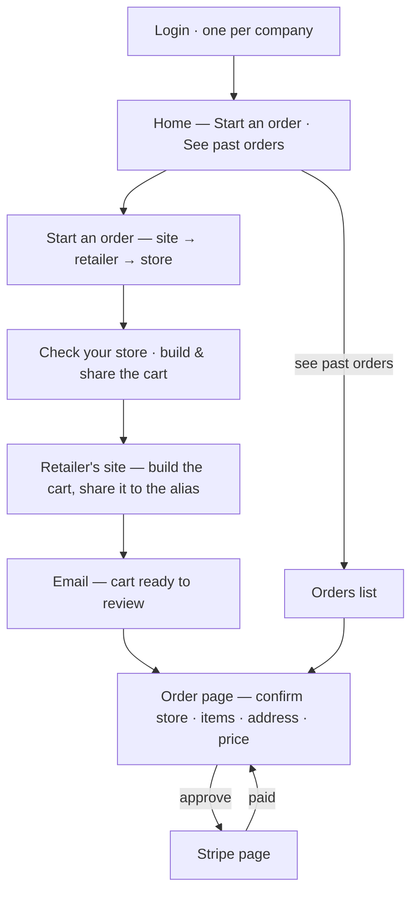

# Company Portal — Wireframes (scratch)

> **Status:** Brainstorm output, not yet promoted to `docs/`. **Revised 2026-09-21** — the flow below is superseded in part; the built mockups are the source of truth.
> Built: `/mockups/start` (home → start an order → email → order page) and `/mockups/orders/detail` (order detail directions + the review/approve wizard). The screen hub shows what is still unbuilt.
> **Superseded 2026-11-18 — payment.** The customer now pays when they approve, not after delivery ([ADR-0011](../docs/adr/0011-pay-on-approval.md)). The Stripe step in the flow, the "You pay after delivery" line, and the Pay CTAs for Delivered and Payment requested below no longer apply. Payments are not built yet.
> Companion reading: [order lifecycle](../docs/architecture/04-order-lifecycle.md) · [customer guide](../docs/runbooks/customer-guide.md) · [ADR-0010](../docs/adr/0010-customer-captures-store-and-address.md).

## Screen flow



## What changed on 2026-09-21

The ASCII wireframes below are the original brainstorm and no longer match. The deltas:

1. **Home is Uber-ish.** One primary action (Start an order), one secondary (See past orders). The alias left home and now lives where it is needed — the last step of the start flow, next to the instructions. A single line appears when an order is waiting for approval; there is no order list on home.
2. **The address and the store are captured up front**, not at checkout. This closes the two gaps the email leaves open — see [ADR-0010](../docs/adr/0010-customer-captures-store-and-address.md). The store list is seeded, nearest-to-site first, and each store carries a verified store-page URL.
3. **The checkout wizard is gone as a separate screen.** The order page confirms what the customer already chose: confirm store → confirm items → confirm delivery → approve. Notes and on-site contact are the only new fields on it.
4. **Instructions are one per screen** in the start flow, with a code-drawn diagram of the retailer's store page — not a screenshot, so there is nothing to re-capture when a retailer redesigns.
5. **"Email me the address" was cut** from the share step.

Superseded decisions below: **#1** (the one-page wizard) and **#2** (the alias card on the orders list) no longer apply. **#3** (status-driven CTA) and **#4** (item thumbnails) still hold; the order page is the `awaiting_customer` state of the order detail.

## Open items

- `order_intents` and `retailer_stores.store_url` are not yet in [03-data-model](../docs/architecture/03-data-model.md) — add them when implementation planning starts.
- ~~The share step still shows a placeholder: we have no reference for the cart's Share button on either site.~~ Superseded 2026-11-18: the start flow's finish step has a built Lowe's how-to with real captures of Email Cart (`web/components/portal/start/lowes-how-to.tsx`). Home Depot has none yet.
- Store seeding: the list, each store's verified URL, and the retailer's own label for it.

## Decisions taken in these wireframes

*(Original brainstorm — read "What changed on 2026-09-21" above before relying on these.)*

1. **Wizard = one page, 3 sections, sticky approve button.** One-shot flow; mobile back-navigation shouldn't strand anyone mid-wizard. Three separate screens buys nothing here.
2. **"Start order" is a card pinned to the top of the Orders list**, not a tab. Every email link lands on this screen, so the alias is always one screen away. "Email me the address" is the mobile workaround — it puts the address in their inbox, which is reachable from inside Home Depot's share dialog.
3. **Order detail's primary CTA is status-driven** (table at the bottom). It is the only screen every order visits, including the dispatcher-completes-on-behalf path that never sees the wizard.
4. **Item thumbnails: yes.** The cart email carries `image_url` per line item; it is the cheapest way to make "did we read your cart right?" glanceable.
5. **Saved job sites: wire the Site dropdown now** — a Phase 4 item, but the wizard's Site field needs it from the start.
6. **"Save as contact" cut.** Home Depot has no contact picker, and OS/browser email autofill is unreliable. Copy + "email me the address" are the paths that actually work.

## 1. Orders list

```
┌──────────────────────────────────────────────────────┐
│  Acme Construction                          [ user ] │
├──────────────────────────────────────────────────────┤
│  ┌────────────────────────────────────────────────┐  │
│  │  Start an order                                │  │
│  │                                                │  │
│  │  Build your cart at Home Depot or Lowe's,      │  │
│  │  then share it to:                             │  │
│  │                                                │  │
│  │  ┌──────────────────────────────────────────┐  │  │
│  │  │ acme@orders.example.com            [ ⧉ ] │  │  │
│  │  └──────────────────────────────────────────┘  │  │
│  │                                                │  │
│  │  Don't check out — the cart is your request.   │  │
│  │  How to share →                                │  │
│  └────────────────────────────────────────────────┘  │
├──────────────────────────────────────────────────────┤
│  Your orders                                         │
│                                                      │
│  #1042   Delivered            $482.80   →            │
│          Home Depot · Sep 17                         │
│  ────────────────────────────────────────────────    │
│  #1039   Awaiting approval    $120.10   →            │
│          Lowe's · Sep 16                             │
└──────────────────────────────────────────────────────┘
```

Empty state: the Start order card, plus "No orders yet — send your first cart."

## 2. Start an order (from the card's "How to share →")

```
┌──────────────────────────────────────────────────────┐
│  ←  Start an order                                   │
├──────────────────────────────────────────────────────┤
│  1 · Build your cart                                 │
│      At homedepot.com or lowes.com.                  │
│      Set the store you'd actually go to.             │
│                                                      │
│  2 · Share it to this address                        │
│      ┌──────────────────────────────────────────┐    │
│      │ acme@orders.example.com            [ ⧉ ] │    │
│      └──────────────────────────────────────────┘    │
│      Tap copy, then paste it into the share form.    │
│                                                      │
│  3 · We email you to confirm                         │
│      Check the items and the price, then approve.    │
│      Nothing is ordered until you approve.           │
│                                                      │
├──────────────────────────────────────────────────────┤
│  [  Copy address  ]  [  Email me the address  ]      │
└──────────────────────────────────────────────────────┘
```

## 3. Order detail (the home screen)

```
┌──────────────────────────────────────────────────────┐
│  ←  Orders                                           │
├──────────────────────────────────────────────────────┤
│  Order #1042                                         │
│  Home Depot · 4 items                                │
│                                                      │
│  ◉ Delivered                                         │
├──────────────────────────────────────────────────────┤
│  Progress                                            │
│    ✓ Received              Sep 16 · 8:02a            │
│    ✓ You approved          Sep 16 · 8:40a            │
│    ✓ Driver assigned       Sep 16 · 9:15a            │
│    ✓ At store              Sep 16 · 10:10a           │
│    ✓ Purchased             Sep 16 · 10:44a           │
│    ✓ On the way            Sep 16 · 11:02a           │
│    ◉ Delivered             Sep 16 · 11:47a           │
│    ○ Payment due                                     │
├──────────────────────────────────────────────────────┤
│  Delivery                                            │
│    421 Commerce Rd, Bldg 3                           │
│    Gate code 4412 · ask for Dave                     │
├──────────────────────────────────────────────────────┤
│  Items (4)                                $412.80    │
│    [▣] Deck screws                1×      $216.60    │
│    [▣] 2×4×8 lumber              12×      $196.20    │
│    Show all →                                        │
├──────────────────────────────────────────────────────┤
│  Price                                               │
│    Materials                              $412.80    │
│    Sizing fee                              $25.00    │
│    Delivery fee                            $45.00    │
│    Total                                  $482.80    │
├──────────────────────────────────────────────────────┤
│  [            Pay $482.80             ]   ← sticky   │
└──────────────────────────────────────────────────────┘
```

Delivered adds the delivery photo and receipt above the CTA. `needs_review` looks the same minus the CTA — the customer just sees "Received · we're reviewing your cart."

## 4. Checkout wizard (one page, three sections)

```
┌──────────────────────────────────────────────────────┐
│  ←  Order #1042                                      │
│     Review & approve                                 │
├──────────────────────────────────────────────────────┤
│  1 · Check the items                                 │
│      We read these from your shared cart:            │
│      ┌──────────────────────────────────────────┐    │
│      │ [▣] Deck screws      1×         $216.60  │    │
│      │ [▣] 2×4×8 lumber    12×         $196.20  │    │
│      └──────────────────────────────────────────┘    │
│      Wrong? Call us — we'll fix it before anything   │
│      is ordered.                                     │
├──────────────────────────────────────────────────────┤
│  2 · Delivery                                        │
│      Site     [ 421 Commerce Rd            ▾ ]       │
│      Notes    [ Gate code 4412, rear entr…   ]       │
│      Contact  [ Dave            ] [ 864-555-0147 ]   │
├──────────────────────────────────────────────────────┤
│  3 · Price                                           │
│      Materials                            $412.80    │
│      Sizing fee                            $25.00    │
│      Delivery fee                          $45.00    │
│      Total                                $482.80    │
├──────────────────────────────────────────────────────┤
│  [        Approve · $482.80           ]  ← sticky    │
│  You pay after delivery. Nothing is ordered until    │
│  you approve.                                        │
└──────────────────────────────────────────────────────┘
```

> Superseded 2026-11-18: approving now takes the customer to pay ([ADR-0011](../docs/adr/0011-pay-on-approval.md)).

## Order detail CTA by status

| Order status            | Primary CTA                                      |
| ----------------------- | ------------------------------------------------ |
| Received / needs review | none — "We're reviewing your cart"               |
| Awaiting your approval  | **Review & approve** → wizard                    |
| Confirmed → On the way  | none — timeline only                             |
| Delivered               | **Pay $482.80** → Stripe (photo + receipt above) |
| Payment requested       | **Pay $482.80** → Stripe                         |
| Paid / closed           | none                                             |

> Superseded 2026-11-18: the two Pay rows no longer apply. Payment happens at approval ([ADR-0011](../docs/adr/0011-pay-on-approval.md)), so nothing is due after delivery.

## Open questions

- Exact alias domain (placeholder `orders.example.com` throughout).
- "Start an order": card-only vs its own screen — decide when we see a real mockup.
