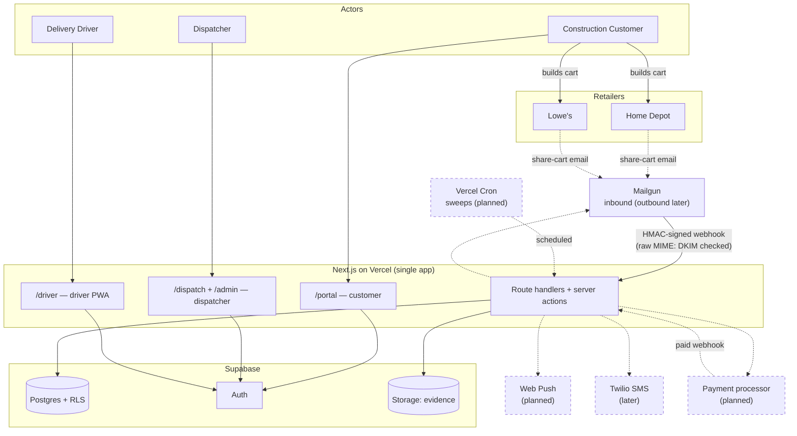
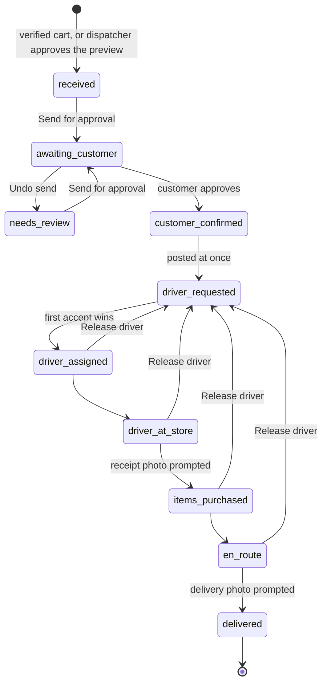
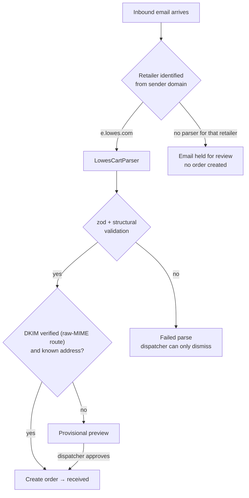
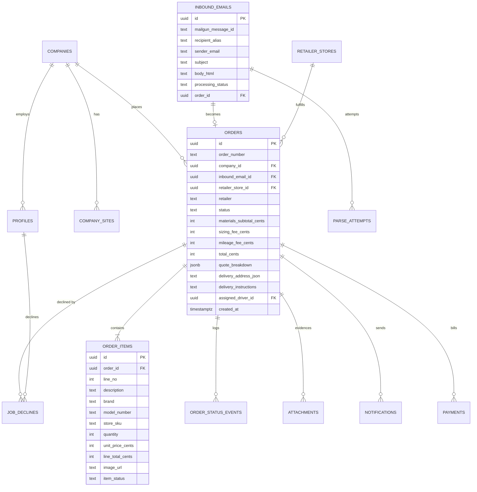

# Delivery App MVP — Systems Architecture & Delivery Plan

Establish the full system architecture, data model, and phased build plan for a construction-site delivery MVP — starting with a repo-committed set of Markdown + Mermaid design documents.

> **Status:** Approved architecture. The full order flow is built up to delivery; payments and notifications are decided but not built (2026-11-18).
> **Owner:** Delivery App team · **Last updated:** 2026-11-18

---

## Summary

Build the systems needed for a construction-site delivery MVP: a Next.js app (role-guarded UIs for customers, dispatchers and drivers) on Supabase, with a Mailgun-driven email-cart intake that parses **Lowe's** share-cart emails into structured orders, a dispatcher console that drives the order through a guarded state machine, a driver job board with first-accept-wins dispatch, and payment when the customer approves.

**What is built today (2026-11-18):**

1. The customer starts an order in the portal (or uses the stable company address) and emails their Lowe's cart to a `delivery+<token>@…` address.
2. Mailgun forwards it to our webhook. On the raw-MIME route (`/api/webhooks/mailgun/mime`), a Lowe's cart whose DKIM signature verifies, sent to a known company or intent address, becomes an order directly. Anything else, and everything on the older parsed-fields route, becomes a preview a dispatcher must approve. Mailgun's forward URL still points at the older route until it is switched.
3. The dispatcher reviews the order, sets the delivery size (Car or Truck), types the fees by hand and sends it for approval. No email is sent; the customer sees it in the portal.
4. The customer approves in the portal. Approval posts the job to drivers at once.
5. The dispatcher copies the job link and sends it to drivers by hand. The first driver to accept gets it, then steps through store, purchase (receipt photo), on the way and delivered (delivery photo).

**Decided, not built:** the customer pays at approval, and only a cleared payment posts the job; Web Push notifications, then Twilio texts later. [05-email-intake](05-email-intake.md) documents the receiving setup.

---

## Source material reviewed

| Document                                                        | What it established                                                               |
| --------------------------------------------------------------- | --------------------------------------------------------------------------------- |
| `External Notes/Low Tech Flow.pdf` (23pp)                       | Full manual runbook, 10 status names, 3 persona guides, email template, fee model |
| `External Notes/Delivery App Workflow.pdf` (4pp)                | Persona step lists, vNext ideas, 14 open questions                                |
| `External Notes/MVP for Delivery App.pdf` (1p)                  | Four intake options, checkout requirements, deferred concepts                     |
| `External Notes/Share Cart Invitation From Anthony Palumbi.eml` | Analyzed field-by-field — see [Findings](#findings-from-the-example-email)        |

---

## Findings from the example email

These five findings were derived by inspecting the real Home Depot share-cart email and drove several locked decisions. They are recorded here because they are the empirical basis for the parser design and the store-capture decision.

| Finding                               | Evidence                                                                                                                                    | Consequence                                                                    |
| ------------------------------------- | ------------------------------------------------------------------------------------------------------------------------------------------- | ------------------------------------------------------------------------------ |
| Full line items are in the email body | `Model #9988872`, `Store SKU #1014148280`, `Aisle`/`Bay` columns, qty `1`, `$216.60`, image URL `…/deckmate-deck-screws-9988872-64_400.jpg` | No scraping needed for items. Parsing is a solved, deterministic problem.      |
| **No store identifier anywhere**      | 0 matches for store name/number/zip across 136KB of HTML. `pickup-store` is an empty CSS wrapper class, not data.                           | Confirms dispatcher-sets-store is required, not a shortcut.                    |
| Shared cart page is bot-blocked       | `curl` on the supplied `sharedCartId` URL → **HTTP 403** (Akamai Bot Manager)                                                               | Fetching the cart link is not a cheap MVP path. Rules out store-scraping.      |
| Items appear twice                    | `desktop_item_list` (visible) and `mobile_item_list` (`display:none`) both contain the cart                                                 | Parser must scope to `desktop_item_list` or dedupe, or every order doubles.    |
| HTML-only, no plain-text part         | Single `text/html` MIME part, `quoted-printable`                                                                                            | Parser operates on HTML; Mailgun's `body-plain` is auto-synthesized and lossy. |

---

## Locked decisions

| Area            | Decision                                                                                  |
| --------------- | ----------------------------------------------------------------------------------------- |
| Persistence     | Supabase (Postgres + Auth + Storage + RLS)                                                |
| Front end       | Next.js App Router, **one app**: `/dispatch` and `/admin` (console), `/driver`, `/portal` |
| Hosting         | Vercel                                                                                    |
| Email in + out  | **Mailgun** inbound webhook. Outbound email not built                                     |
| Sender check    | Our app verifies the retailer's DKIM signature on the raw-MIME route; a verified Lowe's cart to a known address becomes an order directly |
| Retailers       | **Lowe's only.** Home Depot is planned for the pilot; Ace is deferred                     |
| Notifications   | **Web Push** to the home-screen app first; Twilio texts later as a fallback. Decided 2026-11-18, **not built** — nothing is sent today |
| Payments        | **Customer pays at approval**; only a cleared payment approves the order and posts it. Decided 2026-11-18, **not built**; payment account being set up. Replaces pay-after-delivery Stripe Payment Links ([ADR-0006](../adr/0006-stripe-payment-links.md)) |
| Background jobs | **Vercel Cron sweeps** over a notifications outbox + broadcast expiry. No workflow engine. None built yet |
| Intake paths    | Stable company Mailgun address, or the portal's start-an-order flow                      |
| Order identity  | Shared `delivery@` pilot address (dispatcher assigns company); optional portal `delivery+<token>` one-use addresses via migrations `0008`/`0010` |
| Company model   | Company = org, **one portal login** per company                                           |
| Auth            | Email-as-username + password (Supabase Auth)                                              |
| Store capture   | Customer supplies it in optional portal flow; dispatcher collects it for direct-email orders |
| Parsing         | Deterministic parser → schema validation → dispatcher review queue. **LLM fallback deferred** |
| Item metadata   | Email fields only. No enrichment API, no scraping.                                        |
| Delivery size   | **Car or Truck**                                                                          |
| Quote           | **Fees typed by hand** by the dispatcher: materials, sizing fee, mileage fee              |
| Driver comms    | Posted to drivers automatically when the customer approves; dispatcher copies the job link by hand; first accept wins. Push planned, texts later |
| Customer UX     | Simplified portal: login, start an order, history, order detail with delivery progress, approval |
| Photo gates     | **Prompt but never block**; skip requires a reason                                        |
| Parallel run    | **None.** No Slack, no Google Sheets. App is the sole system of record.                   |
| Market          | Upstate South Carolina → Supabase `us-east-1`                                             |
| Environments    | **One Supabase project** for the pilot, no staging (decided 2026-11-18)                  |
| Docs            | Markdown + Mermaid, committed in-repo                                                     |

Each decision has a corresponding ADR in [`docs/adr/`](../adr/README.md).

---

## MVP scope

### In scope

Built:

- Email alias intake → deterministic **Lowe's** cart parse → order created (directly when the DKIM signature verifies on the raw-MIME route; otherwise after dispatcher approval)
- Dispatcher console: review queue, queue tabs from review to delivered, store assignment, Car/Truck size, fee entry, send for approval and undo, driver payout, copy job link, release driver, receipt and delivery photos
- Customer portal: login, start an order, order list + history, order detail with delivery progress and delivery photos, approval (confirm on-site contact and drop-off instructions)
- Driver app (mobile-first, installable to the home screen): job board, posting details before accepting, first-accept-wins, status steps, receipt and delivery photos (skippable with reason)
- Admin: create users (customer, driver, dispatcher), change role or company, deactivate

Decided, not built:

- Payment at approval, with a signed payment webhook
- Web Push: drivers on a new job; customers when sent for approval, driver on the way, and delivered; dispatchers when all drivers decline
- Decline on the driver's job page
- Home Depot parser
- Dispatcher item editing

Later: Twilio texts, outbound email, company and store screens in the admin (companies and stores are added in SQL today).

### Explicitly deferred

Designed for, not built. Each item's extension hook is documented in [12-deferred-and-extension-points.md](12-deferred-and-extension-points.md).

Item substitution · cancellation UI · automated customer status fan-out beyond the planned push events · multi-store orders · parts catalog / concierge procurement · smart iFrame · chat experience · aisle/bay data · product enrichment API · native mobile apps · driver payouts (Stripe Connect) · fee rule engine · Slack integration · staging environment · **Ace parser** · **LLM fallback tier**

---

## Target architecture

Dashed boxes are decided but not built: payments, Web Push, Twilio texts and cron sweeps. Outbound email is not built either.



### Order lifecycle (guarded state machine)

What is built today:



`delivered` is the last step today; nothing moves an order past it. A cart that fails to parse never becomes an order: it stays an inbound email the dispatcher can only dismiss.

**Planned (decided 2026-11-18, not built):** approving takes the customer to pay. The order stays `awaiting_customer` until the payment clears, and only a cleared payment moves it to `customer_confirmed` and posts it. This replaces the old `delivered → payment_requested → paid → closed` design; those values remain in the enum.

`cancelled` exists in the enum from day one, but has no UI in the MVP — that is what makes cancellation a small later addition rather than a refactor.

### Parsing fallback ladder



Every parse attempt is recorded in `parse_attempts` with parser version, output, and errors, so template drift is visible rather than silent. Dispatcher item editing for failed parses is planned. The LLM tier is deferred; when it lands it slots in between `E -->|no|` and `I`.

---

## Data model



Full table list (Phase 1 migrations): `companies`, `profiles`, `company_sites`, `retailer_stores`, `inbound_emails`, `parse_attempts`, `orders`, `order_items`, `order_status_events`, `job_declines`, `attachments`, `notifications`, `payments`, plus enums for `user_role`, `order_status`, `retailer`, `item_status`, `notification_status`, `payment_status`.

Two design choices that protect the deferred features:

- **`order_status_events` is an append-only event log.** Automated customer status emails become a fan-out on this table — no schema change.
- **`quote_breakdown` is jsonb** alongside the scalar fee columns. Adding a fee rule engine later doesn't reshape the order table.

---

## Documentation structure

All 27 documents below are written. See [docs/README.md](../README.md) for the index.

```
docs/
  README.md                              # index + reading order
  architecture/
    00-overview.md                       # this document
    01-system-context.md                 # C4 L1
    02-containers.md                     # C4 L2
    03-data-model.md                     # ERD + table-by-table reference
    04-order-lifecycle.md                # state machine + transition/permission table
    05-email-intake.md                   # Mailgun route, alias scheme, webhook contract
    06-cart-parsing.md                   # parser design, HD field map, fallback ladder
    07-dispatch.md                       # postings, declines, first-accept-wins
    08-notifications.md                  # templates + trigger matrix
    09-payments.md                       # Stripe links + webhook
    10-auth-and-permissions.md           # roles, RLS, route guards
    11-deployment-and-environments.md
    12-deferred-and-extension-points.md  # each deferred item + its hook
  adr/
    0001-supabase-postgres.md
    0002-single-nextjs-app-three-route-groups.md
    0003-mailgun-for-inbound-cart-email.md
    0004-deterministic-parser-with-llm-fallback.md
    0005-inngest-durable-workflows.md
    0006-stripe-payment-links.md
    0007-email-password-auth.md
    0008-dispatcher-assigns-store.md
    0009-inline-intake-and-cron-sweeps.md
    0010-customer-captures-store-and-address.md
  runbooks/
    customer-guide.md
    dispatcher-guide.md
    driver-guide.md
```

---

## Implementation roadmap

### Phase 0 — Design artifacts ✅ complete

1. ✅ Created the `docs/` tree above.
2. ✅ Wrote `00-overview.md`: locked decisions table, MVP in/out scope, the source findings.
3. ✅ Wrote the 12 architecture docs with embedded Mermaid diagrams (context, containers, ERD, state machine, intake sequence, dispatch sequence, delivery + payment sequence, parsing ladder, deployment).
4. ✅ Wrote 8 ADRs — each with context / decision / consequences / alternatives rejected.
5. ✅ Rewrote the three persona runbooks against the _new_ system (the PDFs describe the retired low-tech process).
6. ✅ Wrote `12-deferred-and-extension-points.md`, mapping every deferred item to the specific hook that makes it cheap later, plus a full source-material traceability table.
7. ➖ **Skipped:** SVG exports. Every diagram renders correctly on GitHub, so there was nothing to work around.

**Verified:** 16/16 Mermaid diagrams parse; 104 file links and 11 anchor links resolve. See the [verification checklist](#verification-checklist).

### Phase 1 — Foundation ✅ built

Next.js/Bun app and Supabase schema (migrations `0001`–`0018`, applied by hand in the SQL editor). The pilot has South Carolina Lowe's store data (North Carolina is also seeded). One Supabase project for the pilot, no staging (decided 2026-11-18).

### Phase 2 — Email intake + parsing ✅ built for Lowe's

Mailgun forwards cart emails to two routes. `/api/webhooks/mailgun/inbound` (parsed fields, the current Mailgun setting) turns every parsed cart into a preview a dispatcher approves. `/api/webhooks/mailgun/mime` (raw MIME, migration `0017`) verifies the retailer's DKIM signature; a verified Lowe's cart sent to a known company or intent address becomes an order directly. Mailgun's forward URL still has to be switched to `/mime`. Portal order intents are matched to their cart. Home Depot is planned for the pilot; the AI fallback is deferred.

### Phase 3 — Dispatcher console ✅ built

Review queue · queue tabs (To review, Awaiting approval, Finding driver, With driver, Delivered, All) · order detail (store, Car/Truck size, fees typed by hand, send for approval and undo, driver payout, copy job link, release driver, step times, receipt and delivery photos) · admin for users (create, change role or company, deactivate). Not built: item editing (planned), approving on a customer's behalf, company and store screens (added in SQL).

### Phase 4 — Customer portal ✅ built, payment planned

Login · start an order · order list + history · order detail with delivery progress and delivery photos · approval (confirm on-site contact and drop-off instructions). Not built: payment at approval (decided 2026-11-18) and push notifications.

### Phase 5 — Dispatch + driver app ✅ built, notifications planned

Job board (all open postings) · posting shows payout, store, full delivery address, items and vehicle before accepting · atomic first-accept-wins (`accept_job`) · mobile-first driver UI, installable to the home screen · status steps · receipt and delivery photos with skip-reason. Posting happens automatically when the customer approves; the dispatcher sends the job link by hand. Not built: Decline (planned for the pilot), Web Push (planned), Twilio texts (later).

### Phase 6 — Payments _(decided, not built)_

The customer pays at approval; the order stays `awaiting_customer` until the payment clears, and only a cleared payment approves it and posts it to drivers. Needs a signed payment webhook and a receipt. Waiting on the payment processor account. Replaces the earlier Stripe Payment Link sent on `delivered`.

### Phase 7 — Hardening

Structured logging + error tracking · system-health panel · RLS test suite · concurrency test on the accept race · runbooks. Not started; there is no CI yet.

---

## Verification checklist

Phase 0 self-verification, with the evidence for each item.

- [x] **Every Mermaid block parses.** 16 diagrams across 9 files validated against the `mermaid` parser — not eyeballed. All 16 pass.
- [x] **All documentation links resolve.** 104 file links and 11 anchor links verified programmatically. No dead links.
- [x] **ADR coverage.** 9 ADRs cover the decisions with real trade-offs — persistence, app structure, email vendor, parsing strategy, background work, payments, auth, and store assignment. The remaining locked decisions (fee entry, photo gating, market) are recorded in the decisions table above; they are configuration choices rather than architectural ones and do not warrant a record each.
- [x] **Source traceability.** Every intake option and vNext idea from the source PDFs is mapped to a disposition in [12-deferred-and-extension-points](12-deferred-and-extension-points.md#traceability-source-material-to-disposition).
- [x] **Runbook ↔ state machine consistency.** Dispatcher, driver, and customer guides were checked against the transitions in [04-order-lifecycle](04-order-lifecycle.md). This check caught a real gap: the customer guide's status list omitted `driver_requested` and `payment_requested`, both of which a customer can see. Fixed.
- [x] **Parser field maps match the real emails.** Lowe's is implemented and covered by golden-file tests. Home Depot's map in [06-cart-parsing](06-cart-parsing.md#appendix-home-depot-field-map-reference) was extracted from both actual `.eml` files, including the duplicate-view trap and the Aisle/Bay sub-row (empty in one sample, populated in the other).
- [ ] **Diagram legibility review.** Rendering correctness is verified; _legibility_ needs a human. Confirm the container diagram, ERD, and state machine read clearly before the team relies on them.
- [x] **Open blockers documented** — see below.

### Gaps this verification did not close

- **The Lowe's sample is a single cart.** It has 3 items, which confirms multi-row carts — but it is one sample. A second cart, ideally with a different item count, would strengthen the extractor's evidence before it is trusted.
- **The Lowe's email carries no prices.** Captured and analysed: it contains no money at all — no line totals, no subtotal, no tax. Reconciliation therefore cannot run for Lowe's, so validation is structural and the dispatcher enters the materials cost by hand. See [06-cart-parsing](06-cart-parsing.md).

---

## Risks and considerations

| Risk                                                                          | Mitigation                                                                                                       |
| ----------------------------------------------------------------------------- | ---------------------------------------------------------------------------------------------------------------- |
| **Lowe's gives no prices, so nothing reconciles arithmetically**               | Validation is structural — three independently-derived item counts must agree — and the review queue is the human backstop |
| **An unsupported retailer's cart is invisible in the UI** — it lands in `needs_review` with no order, and unattributed handling is out of scope | Home Depot is unselectable in the portal, so it should be rare. Recorded as a known gap rather than left implicit |
| Template drift silently breaks parsing                                        | Golden-file tests + versioned parser + `parse_attempts` telemetry + review queue as backstop                     |
| Mailgun `forward()` retries if the webhook is slow                            | Persist the email before parsing, re-process duplicates that are still pending, and keep the parser fast         |
| Job-accept race (two drivers accept simultaneously)                           | Enforced by the row-locking state transition on the order, never in app code                                     |
| PII exposure (addresses, phones, receipt photos)                              | RLS on every table, private storage bucket, signed URLs only                                                     |
| Three UIs in one app risks a muddled boundary                                 | Route groups + role guards from commit one; the ADR records when to split                                        |
| "Prompt but never block" photos weakens the dispute evidence trail            | Every skip records a reason and is visible on the order detail and to the dispatcher                             |
| Portal is load-bearing with no email fallback for address/acceptance          | Pilot customers approve (and, once built, pay) themselves; approving on a customer's behalf is not built. Treat portal availability as critical during the pilot |

---

## Open blockers

To resolve before the pilot:

1. **Payment processor account** — a teammate is setting it up. Payment at approval cannot be built until it exists.
2. **Switch Mailgun's forward URL to `/api/webhooks/mailgun/mime`** — a teammate task. Until then every cart waits for dispatcher approval.
3. **More Lowe's samples** — tests cover one full cart and a redacted excerpt of a second; more samples strengthen the extractor.

Later:

- **Twilio account and US carrier (A2P 10DLC) registration** — for texts after push; registration takes several days.
- **A domain, eventually** — the customer-facing alias address changes when the client's Mailgun account replaces the temporary one; see [11-deployment](11-deployment-and-environments.md#swapping-the-mailgun-account).
