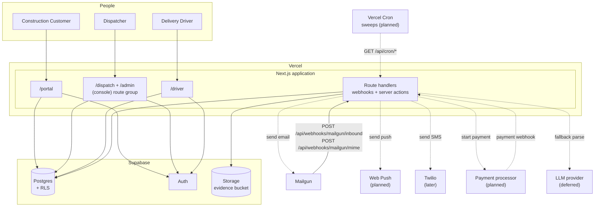

# 02 — Containers (C4 Level 2)

The deployable units, what runs where, and how they communicate.

> **Status:** Web app, database, auth, storage and inbound email are built (2026-11-18). Web Push and payments are decided but not built; scheduled jobs, outbound email and SMS come later. See [00-overview](00-overview.md).

---

## Containers

| Container           | Technology                               | Responsibility                                                                               |
| ------------------- | ---------------------------------------- | -------------------------------------------------------------------------------------------- |
| **Web application** | Next.js (App Router), deployed to Vercel | All three personas' UIs, plus route handlers for webhooks and server actions. Installable to a phone home screen (web manifest) |
| **Database**        | Supabase Postgres                        | System of record. Enforces the state machine's uniqueness constraints and Row Level Security |
| **Auth**            | Supabase Auth                            | Email + password identity for all three roles                                                |
| **Object storage**  | Supabase Storage                         | Receipt and delivery photos. Private bucket, signed URLs                                     |
| **Scheduled jobs**  | Vercel Cron                              | Timed sweeps: the notifications outbox and broadcast expiry. **Not built** (no `/api/cron`, no `vercel.json`) |
| **Inbound email**   | Mailgun Routes                           | Receives cart emails and POSTs them, HMAC-signed, to our webhook. Mailgun does not check DKIM; our app verifies the retailer's DKIM signature on the raw-MIME route |
| **Push**            | Web Push (service worker)                | First channel to drivers, customers and dispatchers. **Planned**, decided 2026-11-18         |
| **Outbound email**  | Mailgun                                  | Transactional email to customers. **Later**                                                  |
| **SMS**             | Twilio                                   | Texts as a fallback after push. **Later**                                                    |
| **Payments**        | Payment processor                        | Payment at approval, with a webhook back into the app. **Planned**, decided 2026-11-18; account being set up |

There is exactly **one application container**. The personas' UIs are routes inside it, not separate deployments. See [ADR-0002](../adr/0002-single-nextjs-app-three-route-groups.md).

---

## Container diagram



Dotted lines are not built yet. Photos upload from the driver's phone straight to the private `evidence` bucket.

---

## What runs inline, and what runs on a schedule

Most work is fast enough to run in the request that triggered it:

| Work                                        | Where it runs                                                                                                                                               |
| ------------------------------------------- | ----------------------------------------------------------------------------------------------------------------------------------------------------------- |
| Parsing an inbound cart                     | **Inline.** The deterministic parser is sub-second; a failure is recorded and lands in the review queue, so nothing is lost by responding after the attempt |
| Sending a notification                      | **Outbox (planned).** The row is written with the state change, attempted immediately, and retried by a cron sweep. Nothing is sent today                   |
| Broadcast expiry                            | **Cron sweep (planned).** A timer per open posting is just a query for orders older than the TTL                                                            |
| Waiting for a customer to complete checkout | **Nothing to run.** The state lives in the database until the customer acts                                                                                 |

So the pattern is: **handlers validate, persist, act, and respond; anything that can fail independently becomes an outbox row a sweep will retry.** There is no workflow engine in the MVP — see [ADR-0009](../adr/0009-inline-intake-and-cron-sweeps.md).

---

## Application module layout

As built (2026-11-18), under `web/`:

```text
web/
  app/
    (auth)/                     # sign-in pages
      login/
      request-access/
    (console)/                  # dispatcher console — role: dispatcher
      dispatch/
        review/                 # queue tabs + order detail (review/[orderId])
          inbound/              # provisional previews of inbound carts
        email/                  # the original cart email for an order
        photo/[attachmentId]/   # signs a fresh URL per request
      admin/                    # user admin — role: dispatcher
        users/
    driver/                     # driver app — role: driver
      jobs/[orderId]/
    portal/                     # customer portal — role: customer
      start/
      orders/[id]/
      photo/[attachmentId]/
    api/
      webhooks/
        mailgun/inbound/route.ts  # Mailgun parsed fields
        mailgun/mime/route.ts     # raw MIME; DKIM verified here
    actions/auth.ts
    manifest.ts                 # home-screen install
    mockups/  design/           # 404 in production
  proxy.ts                      # session refresh + optimistic route guards
  lib/
    dispatch/                   # review queue, gates, actions, payout, driver evidence
    driver/                     # steps, job, actions
    intake/                     # webhook processing, recipient resolution, finalize, MIME/DKIM
    parsers/
      index.ts                  # retailer detection + orchestration
      schema.ts                 # zod schemas
      lowes.ts                  # the only parser today
    portal/                     # customer gate, order, approval, progress
    admin/                      # admin gate, user directory + create
    auth/home.ts                # role → landing page
    mailgun/config.ts
    supabase/
      client.ts                 # browser client
      server.ts                 # RLS-scoped server client
      admin.ts                  # service role — webhooks, admin console
```

There is no `lib/orders/transition.ts`, `lib/notifications` or `lib/payments`. Push and payments will add their own modules when built.

Two rules this layout encodes:

1. **Status changes and guarded edits happen in Postgres, one function per step**: `finalize_inbound_cart`, `update_dispatcher_draft`, `approve_order`, `accept_job`, `advance_job`, `release_driver`, `set_driver_payout`. Each checks the order's current status before writing (a row lock, or a conditional update for `accept_job`); the ones that move the status record an `order_status_events` row. Send for approval and Undo send are conditional updates from the console's server actions. See [04-order-lifecycle](04-order-lifecycle.md).
2. **`lib/parsers/schema.ts` is the shape every parser produces**, so a future parser or manual entry yields the same validated cart.

---

## Communication patterns

| From → To                 | Pattern                                 | Notes                                                |
| ------------------------- | --------------------------------------- | ---------------------------------------------------- |
| Browser → Next.js         | HTTPS, server actions + RSC             | Session cookie from Supabase Auth                    |
| Next.js → Postgres        | `supabase-js` with the user's JWT       | RLS applies                                          |
| Route handlers → Postgres | `supabase-js` with the **service role** | Bypasses RLS by design; webhooks are not user-scoped |
| Mailgun → Next.js         | `POST` form-encoded, HMAC-signed        | Processed inline; must respond within Mailgun's timeout. `/mime` carries the raw message so we can verify DKIM |
| Driver phone → Storage    | Direct upload to the `evidence` bucket  | Storage policies limit drivers to their own job's photos |
| Payment processor → Next.js | `POST`, signature-verified (planned)  | Must ACK fast                                        |
| Next.js → push service    | Web Push (planned)                      | Not built                                            |
| Next.js → Twilio          | REST (later)                            | Called inline, or from a cron sweep                  |
| Vercel Cron → Next.js     | GET `/api/cron/*` (planned)             | Shared-secret header; drains the outbox and expires broadcasts |

---

## Environments

The target is three environments, described in detail in [11-deployment-and-environments](11-deployment-and-environments.md). **For the pilot there is one Supabase project and no staging** (decided 2026-11-18); payments are not built, so the payment column is the plan.

| Environment       | App               | Database                      | Email                          | Payments            |
| ----------------- | ----------------- | ----------------------------- | ------------------------------ | ------------------- |
| Local             | `next dev`        | Supabase CLI (local Postgres) | Mailgun sandbox                | Processor test mode |
| Preview / staging | Vercel preview    | Staging Supabase project (later) | **Separate Mailgun subdomain** | Processor test mode |
| Production        | Vercel production | Production Supabase project   | Production subdomain           | Processor live      |

The separate staging email subdomain is not a nicety — Mailgun routes are per-domain, so sharing a domain across environments would deliver every inbound cart email to both environments.
