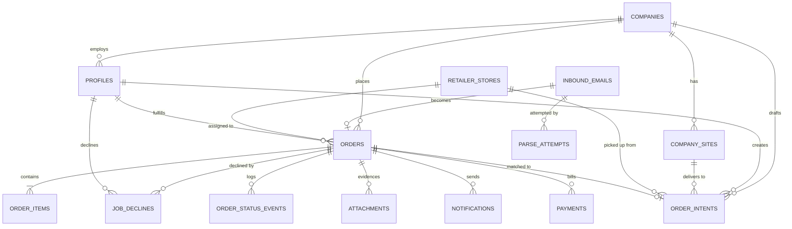

# 03 — Data Model

Schema conventions, the entity relationship diagram, and a table-by-table reference.

> **Status:** Migrations `0001`–`0018` are applied to the pilot Supabase project, by hand in the SQL editor (2026-11-18).

---

## Conventions

| Convention   | Rule                                                                                                      |
| ------------ | --------------------------------------------------------------------------------------------------------- |
| Primary keys | `uuid`, default `gen_random_uuid()`                                                                       |
| Money        | **Integer cents** (`*_cents`), never floats or numeric decimals. `$216.60` → `21660`                      |
| Timestamps   | `timestamptz`, always UTC. `created_at` defaults to `now()`                                               |
| Soft delete  | `active boolean` on reference tables (`companies`, `retailer_stores`, `profiles`). No row is hard-deleted |
| Enums        | Postgres enum types, not free-text columns                                                                |
| Naming       | `snake_case`, plural table names, singular enum type names                                                |
| Addresses    | Stored as discrete columns plus a `jsonb` snapshot on the order                                           |

**Why integer cents:** a delivery total is the sum of a materials subtotal scraped from a retailer email plus fees. Floating point drift in a money field that a customer pays against is not acceptable, and Stripe's API takes integer minor units anyway.

**Why addresses are snapshotted onto the order:** a company may later edit its saved job-site address. The order must preserve what was actually agreed at checkout.

---

## Entity relationship diagram



---

## Enums

| Enum                        | Values                                                                                                                                                                                                                          |
| --------------------------- | ------------------------------------------------------------------------------------------------------------------------------------------------------------------------------------------------------------------------------- |
| `user_role`                 | `dispatcher`, `driver`, `customer`                                                                                                                                                                                              |
| `order_status`              | `received`, `needs_review`, `awaiting_customer`, `customer_confirmed`, `driver_requested`, `driver_assigned`, `driver_at_store`, `items_purchased`, `en_route`, `delivered`, `payment_requested`, `paid`, `closed`, `cancelled` |
| `retailer`                  | `homedepot`, `lowes`                                                                                                                                                                                                            |
| `inbound_processing_status` | `pending`, `parsed`, `needs_review`, `failed`, `ignored`                                                                                                                                                                        |
| `parse_strategy`            | `deterministic`, `llm`, `manual`                                                                                                                                                                                                |
| `item_status`               | `pending`, `purchased`, `unavailable`, `substituted`                                                                                                                                                                            |
| `attachment_kind`           | `receipt`, `delivery`, `item_photo`, `other`                                                                                                                                                                                    |
| `notification_channel`      | `email`, `sms`                                                                                                                                                                                                                  |
| `notification_status`       | `queued`, `sent`, `delivered`, `failed`, `bounced`                                                                                                                                                                              |
| `payment_status`            | `created`, `sent`, `paid`, `expired`, `refunded`                                                                                                                                                                                |
| `order_intent_status`       | `open`, `matched`, `expired`                                                                                                                                                                                                    |
| `delivery_size`             | `car`, `truck` — the vehicle class the sizing fee is keyed to; migration `0006`, Pickup dropped in `0016`                                                                                                                                        |

`cancelled` and `substituted` exist from day one with no UI. That is what makes those features additive later. See [12-deferred-and-extension-points](12-deferred-and-extension-points.md).

---

## Table reference

### `companies`

The construction company. Owns the inbound email alias and the portal login.

| Column          | Type                          | Notes                                                                                    |
| --------------- | ----------------------------- | ---------------------------------------------------------------------------------------- |
| `id`            | uuid PK                       |                                                                                          |
| `name`          | text NOT NULL                 |                                                                                          |
| `order_alias`   | citext UNIQUE NOT NULL        | Local part only, e.g. `fixhome`. Combined with the configured domain to form the address |
| `billing_email` | citext                        |                                                                                          |
| `phone`         | text                          |                                                                                          |
| `notes`         | text                          |                                                                                          |
| `active`        | boolean NOT NULL DEFAULT true |                                                                                          |

`order_alias` is `citext` and unique for stable company addresses. Optional portal-generated addresses use `order_intents.email_token` instead. Migration `0008` reserves the legacy `cart-` prefix and new migration `0010` reserves `delivery+` for opaque intent addresses. The receiving domain must also match the configured domain before attribution.

### `profiles`

One row per authenticated user. Extends `auth.users`.

| Column       | Type                               | Notes                                         |
| ------------ | ---------------------------------- | --------------------------------------------- |
| `id`         | uuid PK                            | References `auth.users(id)` on delete cascade |
| `role`       | user_role NOT NULL                 |                                               |
| `company_id` | uuid FK → companies                | Required when `role = 'customer'`, else null  |
| `full_name`  | text                               |                                               |
| `phone`      | text                               | Driver SMS destination                        |
| `active`     | boolean NOT NULL DEFAULT true      |                                               |
| `created_at` | timestamptz NOT NULL DEFAULT now() |                                               |

**One login per company** in the MVP. The schema permits many profiles per company, so allowing multiple users later is a UI change rather than a migration.

### `company_sites`

Saved job sites, so repeat customers don't re-enter addresses.

| Column                            | Type                           | Notes                                   |
| --------------------------------- | ------------------------------ | --------------------------------------- |
| `id`                              | uuid PK                        |                                         |
| `company_id`                      | uuid FK → companies NOT NULL   |                                         |
| `label`                           | text                           | e.g. "Oakwood Phase 2"                  |
| `address_line1` / `address_line2` | text                           |                                         |
| `city` / `state` / `postal_code`  | text                           |                                         |
| `lat` / `lng`                     | double precision               | Nullable; for future mileage automation |
| `contact_name` / `contact_phone`  | text                           |                                         |
| `instructions`                    | text                           |                                         |
| `is_default`                      | boolean NOT NULL DEFAULT false |                                         |

### `retailer_stores`

Seeded store list. The dispatcher picks from here — this is the only source of store truth, since the cart email carries no store identifier (verified across both Home Depot samples).

| Column                                          | Type                          | Notes                               |
| ----------------------------------------------- | ----------------------------- | ----------------------------------- |
| `id`                                            | uuid PK                       |                                     |
| `retailer`                                      | retailer NOT NULL             |                                     |
| `store_number`                                  | text NOT NULL                 |                                     |
| `name`                                          | text NOT NULL                 | e.g. "North Frisco"                 |
| `address_line1`, `city`, `state`, `postal_code` | text                          |                                     |
| `lat` / `lng`                                   | double precision              |                                     |
| `phone`                                         | text                          |                                     |
| `hours`                                         | jsonb                         |                                     |
| `store_url`                                     | text                          | Verified store page (ADR-0010). Null → the portal falls back to the retailer's homepage |
| `store_label`                                   | text                          | The retailer's own wording for the store; searchable in the portal's store picker and used in the dispatcher's store options |
| `active`                                        | boolean NOT NULL DEFAULT true |                                     |
|                                                 |                               | UNIQUE (`retailer`, `store_number`) |

### `zip_centroids`

Reference data, seeded alongside the store list: one centroid per ZIP, so an address a customer types can be ranked against nearby stores without a geocoding service.

| Column        | Type                      | Notes                                                              |
| ------------- | ------------------------- | ------------------------------------------------------------------ |
| `zip`         | text PK                   | **Text, not an integer** — leading zeros are significant (`00501`)  |
| `city`        | text                      |                                                                    |
| `state`       | text                      |                                                                    |
| `lat` / `lng` | double precision NOT NULL |                                                                    |

A ZIP centroid is **not** the address: it is accurate to a couple of miles in a metro ZIP and can be tens of miles out in a large rural one. It is used for exactly one thing — ordering stores by distance in the start-an-order flow — and is deliberately not a geocoding service: no key, no billing, no network call. It has no foreign key to or from any other table.

On a miss — a ZIP outside the seeded service area, or one created after the source data's vintage — `company_sites.lat`/`lng` are left null and the flow stops showing distances rather than failing.

### `inbound_emails`

Every message that reaches the inbound webhook, stored before any interpretation.

| Column               | Type                                                 | Notes                                                  |
| -------------------- | ---------------------------------------------------- | ------------------------------------------------------ |
| `id`                 | uuid PK                                              |                                                        |
| `mailgun_message_id` | text UNIQUE                                          | **Idempotency key**                                    |
| `message_id_header`  | text                                                 | Original `Message-ID`                                  |
| `recipient`          | text NOT NULL                                        | Full SMTP recipient                                    |
| `recipient_alias`    | citext                                               | Local part, matched against `companies.order_alias`    |
| `sender_email`       | text NOT NULL                                        | Retailer address, e.g. `HomeDepot@order.homedepot.com` |
| `sender_name`        | text                                                 |                                                        |
| `subject`            | text                                                 | Carries the requester's name                           |
| `body_html`          | text                                                 | Raw HTML — the parser's input                          |
| `body_plain`         | text                                                 | Mailgun-synthesized; **not** used for parsing          |
| `stripped_html`      | text                                                 | Quoted-text-removed variant                            |
| `headers`            | jsonb                                                | Full header list                                       |
| `raw_storage_path`   | text                                                 | Original MIME in storage, for reprocessing             |
| `processing_status`  | inbound_processing_status NOT NULL DEFAULT 'pending' |                                                        |
| `company_id`         | uuid FK → companies                                  | Migration `0009`; null for unknown recipient until dispatcher assigns |
| `review_reason`      | text                                                 | Migration `0009`; visible exception/provisional reason |
| `review_status`      | text NOT NULL DEFAULT 'pending'                      | Migration `0009`: pending / approved / dismissed; no order before approval |
| `order_id`           | uuid FK → orders                                     | Null until the cart becomes an order: dispatcher approval, or a verified retailer email (`0017`) |
| `received_at`        | timestamptz NOT NULL                                 |                                                        |

Storing the HTML email and headers before interpreting them makes the parser re-runnable. The full raw MIME is **not** currently stored in `raw_storage_path`; optional Mailgun `store()` (without `notify`) is the temporary backup. Parsed contents are provisional until they become an order. `finalize_inbound_cart` (see [SQL functions](#sql-functions)) creates the order, items, intent claim, audit event and inbound link in one transaction. A dispatcher calls it when approving a preview; the `/mime` webhook calls it with no reviewer when the retailer's DKIM signature verifies (`0017`). A failed parse never becomes an order; the dispatcher can only dismiss it.

### `parse_attempts`

One row per extraction attempt — the telemetry that makes template drift visible.

| Column             | Type                               | Notes                                              |
| ------------------ | ---------------------------------- | -------------------------------------------------- |
| `id`               | uuid PK                            |                                                    |
| `inbound_email_id` | uuid FK → inbound_emails NOT NULL  | Not unique: migration `0004` allows one row per attempt |
| `strategy`         | parse_strategy NOT NULL            |                                                    |
| `parser_version`   | text                               | e.g. `homedepot@1.2.0`                             |
| `succeeded`        | boolean NOT NULL                   |                                                    |
| `confidence`       | numeric                            |                                                    |
| `output`           | jsonb                              | Raw extraction, before validation                  |
| `errors`           | jsonb                              | Validation failures                                |
| `llm_model`        | text                               | Null for deterministic                             |
| `duration_ms`      | int                                |                                                    |
| `created_at`       | timestamptz NOT NULL DEFAULT now() |                                                    |

### `orders`

| Column                      | Type                                     | Notes                                                             |
| --------------------------- | ---------------------------------------- | ----------------------------------------------------------------- |
| `id`                        | uuid PK                                  |                                                                   |
| `order_number`              | text UNIQUE NOT NULL                     | Human reference, e.g. `#2001`. Filled on insert by a trigger from `order_number_seq`, which starts at 2000 (migration `0005`) |
| `company_id`                | uuid FK → companies NOT NULL             |                                                                   |
| `inbound_email_id`          | uuid FK → inbound_emails                 |                                                                   |
| `retailer`                  | retailer NOT NULL                        |                                                                   |
| `retailer_store_id`         | uuid FK → retailer_stores                | **Null until the dispatcher sets it**                             |
| `status`                    | order_status NOT NULL DEFAULT 'received' | See [04-order-lifecycle](04-order-lifecycle.md) |
| `requester_name`            | text                                     | Parsed from the email subject                                     |
| `requester_email`           | citext                                   |                                                                   |
| `materials_subtotal_cents`  | int NOT NULL DEFAULT 0                   | Lowe's share email has no price; zero means unknown until the dispatcher enters an estimate |
| `sizing_fee_cents`          | int NOT NULL DEFAULT 0                   | Dispatcher-entered                                                |
| `mileage_fee_cents`         | int NOT NULL DEFAULT 0                   | Dispatcher-entered                                                |
| `discount_cents`            | int NOT NULL DEFAULT 0                   |                                                                   |
| `tax_cents`                 | int NOT NULL DEFAULT 0                   |                                                                   |
| `total_cents`               | int NOT NULL DEFAULT 0                   | Computed                                                          |
| `quote_breakdown`           | jsonb                                    | Line-item explanation shown to the customer                       |
| `delivery_address`          | jsonb                                    | Intent or dispatcher-confirmed snapshot; includes `contactName` and `contactPhone` after confirmation |
| `delivery_instructions`     | text                                     |                                                                   |
| `site_id`                   | uuid FK → company_sites                  | Provenance only                                                   |
| `delivery_size`             | delivery_size                            | `car` / `truck` — the vehicle class the sizing fee is keyed to. Null until a dispatcher picks one; added by migration `0006`, Pickup dropped in `0016` |
| `assigned_driver_id`        | uuid FK → profiles                       | Written by `accept_job`; cleared by `release_driver`              |
| `driver_payout_cents`       | int, CHECK 0–10,000,000                  | Migration `0013`. What the driver is paid; a company cost, not part of `total_cents`, never shown in the portal. Null until a dispatcher sets it or approval defaults it |
| `customer_confirmed_at`     | timestamptz                              |                                                                   |
| `confirmed_by_profile_id`   | uuid FK → profiles                       | Not written today. Reserved for a dispatcher approving on the customer's behalf (not built) |
| `cancellation_reason`       | text                                     | Unused in MVP; present so cancellation is additive                |
| `created_at` / `updated_at` | timestamptz NOT NULL DEFAULT now()       |                                                                   |

Dispatcher edits during review go through `update_dispatcher_draft`; the payout goes through `set_driver_payout`. See [SQL functions](#sql-functions).

`confirmed_by_profile_id` is the audit answer to "who agreed to this price". When the customer approves in the portal (`approve_order`) it stays null; `customer_confirmed_at` and the status event record who approved and when.

### `order_items`

| Column                   | Type                                        | Notes                                                   |
| ------------------------ | ------------------------------------------- | ------------------------------------------------------- |
| `id`                     | uuid PK                                     |                                                         |
| `order_id`               | uuid FK → orders NOT NULL ON DELETE CASCADE |                                                         |
| `line_no`                | int NOT NULL                                |                                                         |
| `description`            | text NOT NULL                               |                                                         |
| `brand`                  | text                                        |                                                         |
| `model_number`           | text                                        | Home Depot "Model #"                                    |
| `store_sku`              | text                                        | Home Depot "Store SKU #"                                |
| `quantity`               | int NOT NULL DEFAULT 1                      |                                                         |
| `unit_price_cents`       | int                                         | **Derived**: `line_total_cents / quantity`              |
| `line_total_cents`       | int NOT NULL DEFAULT 0                      | As printed in the email                                 |
| `image_url`              | text                                        |                                                         |
| `product_url`            | text                                        | Migration `0012`. The item's link from the cart email (Lowe's click-tracking redirect); HTTPS only, ≤ 2,000 chars. Null for orders finalized before `0012` |
| `aisle` / `bay`          | text                                        | Columns exist in the email's item cell; populated in one sample, empty in the other. Store-scoped — valid only at the store the cart was built against |
| `item_status`            | item_status NOT NULL DEFAULT 'pending'      | Drives the deferred substitution feature                |
| `substituted_by_item_id` | uuid FK → order_items                       | Unused in MVP                                           |
| `note`                   | text                                        |                                                         |

**`unit_price_cents` is derived, not extracted.** The cart email prints only a per-line total (`Item Total $216.60`), not a unit price. For `quantity > 1` it is a division and may not round-trip exactly. The line total is authoritative for money; the unit price is for display.

### `order_status_events`

Append-only audit log. Never updated, never deleted.

| Column             | Type                               | Notes                                                |
| ------------------ | ---------------------------------- | ---------------------------------------------------- |
| `id`               | uuid PK                            |                                                      |
| `order_id`         | uuid FK → orders NOT NULL          |                                                      |
| `from_status`      | order_status                       | Null for the initial event                           |
| `to_status`        | order_status NOT NULL              |                                                      |
| `actor_profile_id` | uuid FK → profiles                 | Null when system-initiated                           |
| `actor_role`       | user_role                          |                                                      |
| `source`           | text                               | Written today: `console`, `portal`, `driver_app`, `system` (approval posting the job), `email` (verified-email order, `0017`) |
| `note`             | text                               |                                                      |
| `metadata`         | jsonb                              |                                                      |
| `created_at`       | timestamptz NOT NULL DEFAULT now() |                                                      |

This table is the hook for the deferred automated customer status notifications: a fan-out on insert turns that feature on without touching the order table.

### `order_intents`

A draft captured by the portal's start-an-order flow: the site, retailer, and store a customer chose **before** they built the cart (ADR-0010). An intent is **not** an order — the order still originates only from a cart email, so email intake is untouched.

| Column                      | Type                                        | Notes                                                       |
| --------------------------- | ------------------------------------------- | ----------------------------------------------------------- |
| `id`                        | uuid PK                                     |                                                             |
| `company_id`                | uuid FK → companies NOT NULL                |                                                             |
| `created_by_profile_id`     | uuid FK → profiles                          | Who started it                                              |
| `site_id`                   | uuid FK → company_sites                     | The saved site, when they picked one                        |
| `delivery_address`          | jsonb                                       | Snapshot; set even for a new address, so the intent stands alone |
| `retailer`                  | retailer NOT NULL                           |                                                             |
| `retailer_store_id`         | uuid FK → retailer_stores                   |                                                             |
| `email_token`               | text UNIQUE, nullable                      | Migration `0008`: 32 lowercase hex characters; new addresses use `delivery+<token>@<configured-domain>` after migration `0010`; legacy `cart-<token>` remains recognized |
| `status`                    | order_intent_status NOT NULL DEFAULT 'open' | Only `open` is written by the portal                        |
| `order_id`                  | uuid FK → orders                            | Set when a cart email is matched to this intent             |
| `matched_at`                | timestamptz                                 |                                                             |
| `created_at` / `updated_at` | timestamptz NOT NULL DEFAULT now()          |                                                             |

`delivery_address` is a snapshot rather than a read-through to `site_id` for two reasons: a customer can type an address that is not yet a saved site, and a saved site can be edited later. The intent records what was agreed, not what the site happens to say today.

`finalize_inbound_cart` sets `matched` when the first eligible email to this token becomes an order, in the same transaction as the order. A failed parse does not consume the intent. It never chooses the company's newest intent for a stable-alias email. A second distinct message to the used token belongs to the same company but receives no old site/store. Expiry sweeps are not built; the token remains a routing identifier for its company. See [12-deferred-and-extension-points](12-deferred-and-extension-points.md).

### `job_declines`

A driver's "no" on an open posting. Append-only; the only per-driver dispatch fact the MVP keeps.

| Column         | Type                                        | Notes                            |
| -------------- | ------------------------------------------- | -------------------------------- |
| `id`           | uuid PK                                     |                                  |
| `order_id`     | uuid FK → orders NOT NULL                   |                                  |
| `driver_id`    | uuid FK → profiles NOT NULL                 |                                  |
| `reason`       | text                                        | Optional                         |
| `created_at`   | timestamptz NOT NULL DEFAULT now()          |                                  |
|                |                                             | UNIQUE (`order_id`, `driver_id`) |

**Decline is not built yet:** the table exists and `get_open_jobs_for_driver` already hides a job the caller declined, but no screen writes a row. Planned for the pilot: declines do not change the order's status, and when every driver has declined, the console flags "All drivers declined" at the top of Finding driver. There is deliberately **no per-driver offer table**: at MVP scale every active driver sees every posting, so the board is a query over `orders` and the only assignment state is `orders.assigned_driver_id`. See [07-dispatch](07-dispatch.md).

### `attachments`

| Column         | Type                               | Notes                                 |
| -------------- | ---------------------------------- | ------------------------------------- |
| `id`           | uuid PK                            |                                       |
| `order_id`     | uuid FK → orders NOT NULL          |                                       |
| `kind`         | attachment_kind NOT NULL           |                                       |
| `storage_path` | text                               | Path in the private `evidence` bucket, `<order id>/…`. Nullable since `0013` |
| `content_type` | text                               |                                       |
| `size_bytes`   | int                                |                                       |
| `uploaded_by`  | uuid FK → profiles                 |                                       |
| `skip_reason`  | text                               | Set when a prompted photo was skipped |
| `created_at`   | timestamptz NOT NULL DEFAULT now() |                                       |

`skip_reason` is what makes "prompt but never block" auditable rather than a silent gap in the evidence trail. Check `attachments_file_or_reason` (`0013`): a row has a `storage_path` or a non-blank `skip_reason`. A skipped photo is a row with a reason and no file. `advance_job` writes the rows: `receipt` at Items purchased, `delivery` at Delivered.

Read policy (`0013`): customers see `delivery` rows on their own orders, never the receipt; dispatchers and the assigned driver see both.

#### Storage: the `evidence` bucket

Migration `0013` creates the private `evidence` bucket: 25 MB per file, JPEG, PNG, WebP or HEIC/HEIF only. Files live under `<order id>/`. The driver's phone uploads straight to it; the app serves files through short-lived signed URLs (`/dispatch/photo/[id]`, `/portal/photo/[id]`).

| Policy on `storage.objects` | Command | Who |
| --- | --- | --- |
| `evidence_driver_insert` | insert | The assigned driver, while the order is `driver_at_store` or `en_route` (the two photo steps) |
| `evidence_dispatcher` | all | Dispatchers |
| `evidence_read` | select | Anyone who may read the matching `attachments` row; the assigned driver for files on their job |
| `evidence_driver_delete` | delete | `0018`. The driver who uploaded the file (`owner_id`), while still at a photo step on that job, and only if no `attachments` row points at it — clears a failed step's leftover upload |

### `notifications`

| Column                | Type                                          | Notes                          |
| --------------------- | --------------------------------------------- | ------------------------------ |
| `id`                  | uuid PK                                       |                                |
| `order_id`            | uuid FK → orders                              |                                |
| `channel`             | notification_channel NOT NULL                 |                                |
| `template_key`        | text NOT NULL                                 |                                |
| `to_address`          | text NOT NULL                                 |                                |
| `subject`             | text                                          |                                |
| `body`                | text                                          | Rendered                       |
| `provider`            | text                                          | `mailgun` or `twilio`          |
| `provider_message_id` | text                                          |                                |
| `status`              | notification_status NOT NULL DEFAULT 'queued' |                                |
| `send_approved`       | boolean NOT NULL DEFAULT false                | Migration `0007`; old and new rows are held until a future sender explicitly opts in |
| `error`               | text                                          |                                |
| `attempts`            | int NOT NULL DEFAULT 0                        | Outbox retry counter           |
| `dedupe_key`          | text UNIQUE                                   | Prevents double-sends on retry |
| `sent_at`             | timestamptz                                   |                                |
| `created_at`          | timestamptz NOT NULL DEFAULT now()            |                                |

Nothing writes this table yet: no notifications are sent (see [08-notifications](08-notifications.md)). `dedupe_key` (typically `order_id:template_key`) is essential: sends are retried by the outbox sweep, and a customer receiving two payment requests is a trust problem.

### `payments`

| Column                   | Type                                      | Notes               |
| ------------------------ | ----------------------------------------- | ------------------- |
| `id`                     | uuid PK                                   |                     |
| `order_id`               | uuid FK → orders NOT NULL                 |                     |
| `provider`               | text NOT NULL DEFAULT 'stripe'            |                     |
| `amount_cents`           | int NOT NULL                              |                     |
| `currency`               | text NOT NULL DEFAULT 'usd'               |                     |
| `stripe_payment_link_id` | text                                      |                     |
| `stripe_session_id`      | text UNIQUE                               | Webhook correlation |
| `url`                    | text                                      |                     |
| `status`                 | payment_status NOT NULL DEFAULT 'created' |                     |
| `paid_at`                | timestamptz                               |                     |
| `raw`                    | jsonb                                     |                     |
| `created_at`             | timestamptz NOT NULL DEFAULT now()        |                     |

---

## Indexes

Beyond primary and foreign keys:

| Table                 | Index                                   | Purpose                          |
| --------------------- | --------------------------------------- | -------------------------------- |
| `orders`              | (`status`, `created_at`)                | Dispatcher board ordering        |
| `orders`              | (`company_id`, `created_at` desc)       | Customer order history           |
| `orders`              | (`assigned_driver_id`, `status`)        | Driver's active jobs             |
| `orders`              | unique (`order_number`)                 | Human reference lookup           |
| `inbound_emails`      | unique (`mailgun_message_id`)           | Idempotency                      |
| `inbound_emails`      | (`recipient_alias`, `received_at` desc) | Per-company intake history       |
| `inbound_emails`      | (`received_at`) where no order and `review_status = 'pending'` | Review queue; migration `0009` |
| `orders`              | unique (`inbound_email_id`)             | One order per inbound email      |
| `job_declines`        | unique (`order_id`, `driver_id`)        | One decline per driver per order |
| `job_declines`        | (`order_id`)                            | Order card: who declined         |
| `order_status_events` | (`order_id`, `created_at`)              | Status timeline                  |
| `order_intents`       | (`company_id`, `created_at` desc)       | A company's own intents          |
| `order_intents`       | (`status`, `created_at`)                | Sweep over abandoned intents     |
| `order_intents`       | unique (`order_id`)                     | One intent per order             |
| `order_intents`       | unique (`email_token`)                  | One opaque receiving token per optional portal intent; migration `0008` |
| `notifications`       | unique (`dedupe_key`)                   | Send idempotency                 |
| `notifications`       | (`status`, `created_at`)                | Outbox drain                     |
| `parse_attempts`      | (`inbound_email_id`, `created_at`)      | Parse diagnostics                |

---

## Row Level Security

RLS is enabled on every table in `public`. Policies are summarised here and specified in full in [10-auth-and-permissions](10-auth-and-permissions.md).

| Table                              | Customer           | Driver                                                 | Dispatcher |
| ---------------------------------- | ------------------ | ------------------------------------------------------ | ---------- |
| `companies`                        | own row            | —                                                      | all        |
| `profiles`                         | own row            | own row                                                | all        |
| `company_sites`                    | own company (read, insert) | —                                              | all        |
| `retailer_stores`                  | read               | read                                                   | all        |
| `zip_centroids`                    | read               | read                                                   | all        |
| `orders`                           | own company        | assigned only; open postings via `get_open_jobs_for_driver` and `get_job_posting` | all        |
| `order_items`                      | via order          | via order                                              | all        |
| `order_status_events`              | via order          | via order                                              | all        |
| `order_intents`                    | own company (insert, read) | —                                              | all        |
| `job_declines`                     | —                  | own declines (insert + read)                           | all        |
| `attachments`                      | `delivery` rows on own orders | via order                                   | all        |
| `notifications`                    | —                  | —                                                      | all        |
| `payments`                         | own company (read) | —                                                      | all        |
| `inbound_emails`, `parse_attempts` | —                  | —                                                      | all        |

The Mailgun webhooks use the **service role** and bypass RLS deliberately — they have no user context. The other uses (admin user management, a dispatcher approving an inbound cart) are listed in [10-auth-and-permissions](10-auth-and-permissions.md#service-role-usage).

---

## SQL functions

Status changes and the writes customers and drivers may make go through these functions. Each one locks the order row (`for update`), checks the caller's role and the order's current status, and writes the change and its `order_status_events` row in one transaction. The checks live inside the functions, not in table constraints. The two exceptions, Send for approval and Undo send, are direct updates from the dispatcher console (see [04-order-lifecycle](04-order-lifecycle.md)).

| Function | Migration | Security | Called by | What it does |
| --- | --- | --- | --- | --- |
| `is_dispatcher()`, `is_driver()`, `current_company_id()` | `0001` | definer | RLS policies, functions | Role helpers; all require `profiles.active` |
| `set_order_number()` | `0005` | trigger | Insert on `orders` | Fills `order_number` as `#` + the next `order_number_seq` value |
| `finalize_inbound_cart(inbound_email_id, company_id, items, reviewer_id, requester_email, intent_id)` | `0009`, replaced in `0010`, `0012`, `0017` | invoker; `service_role` only | Dispatcher approval (`approveInboundEmail`), `/mime` webhook | Creates the order (`received`), its items (incl. `product_url`), the first status event, claims the intent, links the inbound email. A null `reviewer_id` (`0017`) means a verified retailer email: the event's `source` is `email` and it has no actor. A non-null reviewer must be an active dispatcher |
| `update_dispatcher_draft(order_id, kind, values)` | `0011`, replaced in `0016` | invoker | Dispatcher review | Saves the store, delivery address + contact, or quote (size, materials, sizing and mileage fees, total) while the order is `received`/`needs_review`. Writes a same-status audit event. Since `0016` the size must be `car` or `truck` |
| `approve_order(order_id, contact_name, contact_phone, instructions)` | `0012`, replaced in `0013` | definer | Customer, portal | From `awaiting_customer` only. Checks the caller is an active customer of the order's company, and that the order has an address, a store, items and a total above zero. Saves the on-site contact and drop-off instructions, defaults the payout, sets `customer_confirmed_at`, and moves the order to `driver_requested`, writing two events: `awaiting_customer → customer_confirmed` and `customer_confirmed → driver_requested` |
| `default_driver_payout_cents(sizing, mileage)` | `0013` | immutable | `approve_order` | 90% of sizing fee + mileage fee, rounded. A placeholder rule; the console prefills the same figure in TypeScript (`web/lib/dispatch/payout.ts`) |
| `set_driver_payout(order_id, payout_cents)` | `0013` | invoker | Dispatcher | Sets the payout from `received` through `driver_requested`; locked once a driver accepts |
| `get_open_jobs_for_driver()` | `0001`, replaced in `0015` | definer | Driver Jobs page | Lists `driver_requested` orders (store, item count, posted time) the caller has not declined. `0015` added the check that the caller is a driver or dispatcher |
| `get_job_posting(order_id)` | `0013`, replaced in `0014`, recreated in `0016` | definer | Job link | The posting: payout, store, full delivery address, items, size. Never the on-site contact or drop-off notes. Returns nothing unless the order is posted, is the caller's, or the caller is a dispatcher |
| `accept_job(order_id)` | `0013` | definer | Driver | First accept wins: a conditional update from `driver_requested` with no driver. Returns `accepted` (also on a retry by the winner) or `taken` |
| `advance_job(order_id, to_status, photo_path, content_type, size_bytes, skip_reason)` | `0013` | definer | Assigned driver, dispatcher | One step forward: `driver_assigned → driver_at_store → items_purchased → en_route → delivered`. Items purchased and Delivered need a photo already in the `evidence` bucket or a skip reason, and write the `attachments` row. A repeated tap that already landed is success |
| `release_driver(order_id)` | `0014` | invoker | Dispatcher | From any of `driver_assigned`…`en_route`: clears the driver and moves the order back to `driver_requested`. Photos stay; the payout unlocks |

`definer` functions run with the owner's rights because customers and drivers hold no write policy on `orders`; each one checks the caller explicitly. All pin `search_path`.

---

## Migrations

Schema changes are **versioned SQL files applied in order** — Flyway-style, not dashboard edits. Three rules:

1. **`supabase/migrations/0001_baseline.sql` is the base script.** It creates everything above — enums, tables, indexes, the RLS helper functions, and every policy — in one pass, against a database that has none of those objects.
2. **Never edit a migration that has been applied anywhere.** A fix, a new column, or a new policy is a new file with the next number. Editing an applied file means environments silently diverge, and there is no way to tell from the repo which of them actually has the change.
3. **Files apply in filename order.** The number *is* the version.

| File                            | Purpose                                                                                          |
| ------------------------------- | ------------------------------------------------------------------------------------------------ |
| `0001_baseline.sql`             | The base script — the full schema. Applied once per environment, then frozen.                     |
| `0002_<change>.sql`             | One incremental change.                                                                          |
| `0003_<change>.sql`             | …and so on, one file per change, never a bulk re-write of what came before.                       |

`0002_order_intents_and_store_urls.sql` adds `order_intents`, the two `retailer_stores` columns above, and the customer insert policy on `company_sites`. `0003_zip_centroids.sql` adds the ZIP reference table. The rest:

| File | Change |
| --- | --- |
| `0004_parse_attempts_per_tier.sql` | Drops the unique constraint on `parse_attempts.inbound_email_id`: one row per attempt |
| `0005_order_number_sequence.sql` | `order_number_seq` (from 2000) and the trigger that fills `order_number` (`#2001`) |
| `0006_order_delivery_size.sql` | `delivery_size` enum and `orders.delivery_size` |
| `0007_hold_unsent_notifications.sql` | `notifications.send_approved`, default false |
| `0008_intent_mail_tokens.sql` | `order_intents.email_token`; reserves the `cart-` alias prefix |
| `0009_inbound_review_and_finalization.sql` | `inbound_emails` review columns and queue index; `finalize_inbound_cart` |
| `0010_delivery_intent_addresses.sql` | Reserves the `delivery+` prefix; finalization accepts `delivery+<token>` |
| `0011_dispatcher_draft_updates.sql` | `update_dispatcher_draft` |
| `0012_customer_approval_and_item_links.sql` | `order_items.product_url`; finalization stores it; `approve_order` |
| `0013_driver_jobs.sql` | `orders.driver_payout_cents` and the payout functions; approval posts the job; `get_job_posting`, `accept_job`, `advance_job`; nullable `attachments.storage_path`; `evidence` bucket and policies |
| `0014_posting_details_and_release.sql` | Posting shows full address and items; `release_driver` |
| `0015_open_jobs_role_check.sql` | `get_open_jobs_for_driver` requires a driver or dispatcher |
| `0016_car_and_truck.sql` | `delivery_size` becomes `car`/`truck`; existing `pickup` rows become `truck` |
| `0017_verified_cart_orders.sql` | `finalize_inbound_cart` accepts a null reviewer for verified retailer email |
| `0018_evidence_driver_delete.sql` | `evidence_driver_delete` storage policy |

Naming is zero-padded four digits plus a short `snake_case` description: `0002_add_order_photos.sql`. The Supabase CLI's own matcher accepts any numeric prefix (`^([0-9]+)_(.*)\.sql$`), so this numbering works both by hand and with `supabase db push`.

Applying them:

The pilot project has had every file applied by hand in the SQL editor, so it has no `db push` history. Keep doing that, or link and push only after recording what is already applied.

```bash
# By hand: run each file, in order, in the Supabase SQL editor.
# Or, once the project is linked:
supabase link --project-ref <ref>
supabase db push
```

The base script is deliberately **not** idempotent — a second run fails on the first `create type`. A baseline applied twice means migration state has been lost track of, and failing loudly is better than half-applying.

**Rollback posture:** forward-only. Additive changes (a new nullable column, a new table, a new enum value) are safe to ship and are reverted by simply not using them. Destructive changes (dropping a column, narrowing a type) take two deploys: stop using it, then remove it in a later release.

**RLS policies ship in the same migration as the table they protect** — never as a follow-up. A table that exists without its policies is a table with no access control, and the gap between the two migrations is a real exposure.

### Seed data

Reference rows that every environment needs (the `retailer_stores` list) live in `supabase/seed/`, are **idempotent** so they can be re-run safely, and are applied *after* migrations — never as part of them. A migration defines structure; a seed defines rows.

`supabase/seed/0001_dev.sql` is the dev seed: one demo company and its two sites, the 118 North Carolina Lowe's stores from `External Notes/lowes-nc-stores.json` (with `store_url` and `store_label`), and four demo orders. It is **idempotent and corrective** — re-running refreshes the rows it owns rather than skipping them, which is what lets it backfill columns added by a later migration.

`supabase/seed/0002_zip_centroids.sql` is **reference** data rather than demo data: 1,620 ZIP centroids for North and South Carolina, generated from `External Notes/ZIPGOLD.csv` (2011 vintage). It is scoped to the service area so the file stays small enough to apply through the SQL editor; a ZIP outside those states is a miss, which the flow handles. It is idempotent and corrective as well, so a newer source file can be dropped in and applied the same way.

`supabase/seed/0003_sc_stores.sql` is **reference** data too: the 52 South Carolina Lowe's stores from `External Notes/lowes-sc-stores.json` (with `store_url` and `store_label`). It holds stores only — no demo rows — so it can be applied to a deployed environment through the SQL editor. Same upsert on `(retailer, store_number)` as the dev seed, so it is safe to re-run.

There is still no Home Depot list, so the seeded stores are Lowe's only. The portal derives which retailers to offer from the stores that exist, so seeding Home Depot later is a seed change and not a code change.

The service area is **Upstate SC**, matching the checklist in [11-deployment-and-environments](11-deployment-and-environments.md). The North Carolina stores stay seeded and active. The dev seed's demo company is still in Charlotte NC — a demo choice only.

