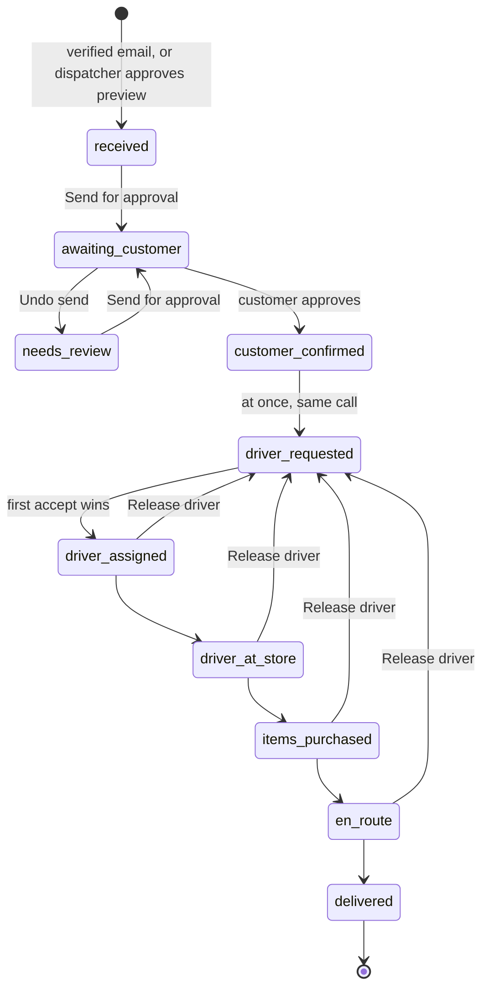

# 04 — Order Lifecycle

The state machine, who may trigger each transition, and what happens as a side effect.

> **Status:** Built from order creation through `delivered` (migrations `0009`–`0018`, all applied). Nothing moves an order past `delivered` yet. Payment, cancellation and notifications are not built.

---

## Where status changes happen

There is no single TypeScript choke point. Each transition is its own SQL function, plus two direct updates from the dispatcher console:

| Change | Where |
| --- | --- |
| Order created (`received`) | `finalize_inbound_cart` — called by the `/mime` webhook or by a dispatcher approving an inbound preview |
| Send for approval, Undo send | Direct update in `web/lib/dispatch/actions.ts` (`sendForApproval`, `undoSendForApproval`), conditional on the current status, then a separate event insert |
| Customer approval | `approve_order` |
| Accept | `accept_job` |
| Driver steps | `advance_job` |
| Release driver | `release_driver` |

Each function locks the order row, checks the caller's role and the current status, and writes the change and its `order_status_events` row in one transaction. The rules live **inside these functions**, not in table constraints. Customers and drivers hold no write policy on `orders`, so for them the functions are the only way in. Dispatchers do hold a write policy on `orders` (RLS `for all`), so the database does not stop a dispatcher session from writing any status; the console only offers the transitions below. Function details are in [03-data-model](03-data-model.md#sql-functions).

No transition sends an email, text or push. See [08-notifications](08-notifications.md).

---

## States

| State                | Meaning today                                                                                          | Terminal |
| -------------------- | ------------------------------------------------------------------------------------------------------ | -------- |
| `received`           | Order created from a cart email; waiting for dispatcher review                                         |          |
| `needs_review`       | Back in review after a dispatcher used Undo send. Reviewed the same way as `received`                  |          |
| `awaiting_customer`  | Sent for approval; the customer sees it in the portal. No email is sent                                |          |
| `customer_confirmed` | Recorded at approval only: `approve_order` moves straight on to `driver_requested`                     |          |
| `driver_requested`   | Posted to drivers ("Finding driver"); no driver has accepted                                           |          |
| `driver_assigned`    | A driver has accepted                                                                                  |          |
| `driver_at_store`    | Driver tapped "I'm at the store"                                                                       |          |
| `items_purchased`    | Materials bought; receipt photo captured or skipped with a reason                                      |          |
| `en_route`           | Driver tapped "On my way"                                                                              |          |
| `delivered`          | Delivered; delivery photo captured or skipped with a reason. The last step today                       |          |
| `payment_requested`  | Unused. Will be redone when payments are built                                                         |          |
| `paid`               | Unused. Will be redone when payments are built                                                         |          |
| `closed`             | Unused                                                                                                 | ✓        |
| `cancelled`          | Unused; cancellation is not built                                                                      | ✓        |

A cart that fails to parse never becomes an order. It stays an inbound exception in the review queue, and the dispatcher can only dismiss it ([05-email-intake](05-email-intake.md)). Dispatcher item editing is planned.

---

## State diagram

---

## Transition table

| #  | From                              | To                   | Actor      | Guard                                                   | Side effects                                                                                       |
| -- | --------------------------------- | -------------------- | ---------- | ------------------------------------------------------- | -------------------------------------------------------------------------------------------------- |
| 1  | —                                 | `received`           | system     | `/mime` webhook: retailer DKIM verified, Lowe's cart parsed, known company or intent address | `finalize_inbound_cart` with no reviewer; event `source = 'email'`; inbound email → `parsed`; intent claimed |
| 2  | —                                 | `received`           | dispatcher | Approving a validated Lowe's preview; active dispatcher; active company | `finalize_inbound_cart`; event `source = 'console'`; same writes as #1                             |
| 3  | `received` / `needs_review`       | `awaiting_customer`  | dispatcher | Review gates pass: Items, Store, Address & contact, Size & price (sizing and mileage each ≥ $0.50). Checked in `canSendForApproval` (TypeScript) | Event "sent for approval — no email sent". The customer sees it in the portal                      |
| 4  | `awaiting_customer`               | `needs_review`       | dispatcher | Customer has not approved yet                           | Event "send for approval undone"                                                                   |
| 5  | `awaiting_customer`               | `customer_confirmed` | customer   | Caller is an active customer of the order's company; address, store, items present; total > 0; valid contact name and phone | Saves on-site contact and drop-off instructions; `customer_confirmed_at` set                       |
| 6  | `customer_confirmed`              | `driver_requested`   | system     | Same call as #5                                         | Payout defaulted if unset (`default_driver_payout_cents`); event "Posted to drivers — no text sent" |
| 7  | `driver_requested`                | `driver_assigned`    | driver     | Order still `driver_requested`; no driver assigned      | `assigned_driver_id` set; payout locked; job leaves Open jobs                                      |
| 8  | `driver_assigned`                 | `driver_at_store`    | driver     | Caller is the assigned driver (or a dispatcher)         |                                                                                                    |
| 9  | `driver_at_store`                 | `items_purchased`    | driver     | As #8; receipt photo in `evidence` **or** a skip reason | `attachments` row (`receipt`)                                                                      |
| 10 | `items_purchased`                 | `en_route`           | driver     | As #8                                                   |                                                                                                    |
| 11 | `en_route`                        | `delivered`          | driver     | As #8; delivery photo **or** a skip reason              | `attachments` row (`delivery`); the customer sees the photo                                        |
| 12 | `driver_assigned` … `en_route`    | `driver_requested`   | dispatcher | Order is with a driver, not yet delivered               | `assigned_driver_id` cleared; payout unlocks; photos kept; same job link                           |

Transitions 5 and 6 happen in one `approve_order` call and write two events, so the order is never left in `customer_confirmed`.

### Not built

- **Payment.** Decided 2026-11-18, not built: approving takes the customer to pay, and the order stays `awaiting_customer` until the payment clears. Only a cleared payment approves the order and posts it to drivers. `payment_requested`, `paid` and `closed` are unused today; the payment states will be redone when payments are built. See [09-payments](09-payments.md).
- **Decline.** Planned for the pilot: a decline does not change status; when every driver has declined, the console flags "All drivers declined".
- **Cancellation**, a dispatcher approving on the customer's behalf, and anything after `delivered`.

### Deliberate omissions

- **No backwards driver steps.** `advance_job` only moves one step forward; a repeated tap that already landed is success. A wrong tap is corrected by a dispatcher advancing, or by Release driver.
- **No transition out of `needs_review` to `received`.** Both are review states; Send for approval works from either.

---

## Traceability: old runbook statuses

The low-tech process used Google Sheets status names. Every one maps to a state above.

| Runbook status             | New state            | Notes                                                                                        |
| -------------------------- | -------------------- | -------------------------------------------------------------------------------------------- |
| Received                   | `received`           |                                                                                              |
| Delivery Address Requested | `awaiting_customer`  | Renamed — the state also covers item verification and price acceptance, not just the address |
| _(implicit)_               | `customer_confirmed` | Made explicit as an event. The runbook treated this as an email exchange with no status      |
| Driver Requested           | `driver_requested`   |                                                                                              |
| Driver Found               | `driver_assigned`    |                                                                                              |
| Driver At Store            | `driver_at_store`    |                                                                                              |
| Items Purchased            | `items_purchased`    |                                                                                              |
| Driver En Route            | `en_route`           |                                                                                              |
| Delivered                  | `delivered`          |                                                                                              |
| Payment Requested          | `payment_requested`  | Unused; payment is planned at approval instead                                               |
| _(implicit)_               | `paid`               | Unused; to be redone with payments                                                           |
| Order Final                | `closed`             | Unused                                                                                       |
| —                          | `needs_review`       | Used only after Undo send                                                                    |
| —                          | `cancelled`          | Defined but unused                                                                           |

---

## Permission matrix

| Transition                                         | Dispatcher | Driver          | Customer | System |
| -------------------------------------------------- | ---------- | --------------- | -------- | ------ |
| → `received`                                       | ✓          |                 |          | ✓      |
| `received` / `needs_review` → `awaiting_customer`  | ✓          |                 |          |        |
| `awaiting_customer` → `needs_review`               | ✓          |                 |          |        |
| `awaiting_customer` → `customer_confirmed` → `driver_requested` |  |          | ✓        |        |
| `driver_requested` → `driver_assigned`             |            | ✓               |          |        |
| `driver_assigned` → … → `delivered`                | ✓          | ✓ assigned only |          |        |
| `driver_assigned` … `en_route` → `driver_requested` | ✓         |                 |          |        |

Drivers may only ever act on **their own assigned order**. `advance_job` checks that itself; it is not a separate authorisation layer.

---

## Invariants

Enforced inside the functions above, not by database constraints, unless noted. The numbers are stable: migration comments cite them (`approve_order` cites 1, 4 and 7), so a retired invariant keeps its number.

1. An order at or past `driver_requested` had a delivery address, a store, at least one item and `total_cents > 0` when it was approved (`approve_order`).
2. `status` in (`driver_assigned`, `driver_at_store`, `items_purchased`, `en_route`) implies `assigned_driver_id IS NOT NULL`. `accept_job` sets both together; `release_driver` clears both together. (`delivered` also keeps the driver.)
3. _Retired until payments are built:_ `status = 'paid'` implies a paid `payments` row. Pay on approval will replace it ([09-payments](09-payments.md)).
4. `retailer_store_id IS NOT NULL` for every status at or past `awaiting_customer` (Send gate and `approve_order`).
5. A driver declines a given order at most once — a unique constraint on `job_declines` (`order_id`, `driver_id`).
6. Every order created by `finalize_inbound_cart` has exactly one `order_status_events` row with `from_status IS NULL` — its creation.
7. `order_items` is non-empty for every order: `finalize_inbound_cart` requires 1–100 items.
8. `driver_payout_cents` does not change once a driver has accepted (`set_driver_payout`), until a release.
9. Items purchased and Delivered each have an `attachments` row with a file or a skip reason (`advance_job`; the file-or-reason check is a table constraint).

---

## Failure handling

| Situation                       | Behaviour                                                                                                                                    |
| ------------------------------- | -------------------------------------------------------------------------------------------------------------------------------------------- |
| Wrong status for the transition | The function raises an error; no state change. The console shows an error in the bottom bar                                                 |
| Review gate unresolved          | Send for approval refuses; clicking Send scrolls to and highlights what is missing                                                           |
| Two dispatchers send at once    | The update is conditional on the status, so it moves once and records one event                                                              |
| Undo send races the customer    | Conditional on `awaiting_customer`: whichever lands first wins; the dispatcher sees an error if the customer approved first                  |
| Two drivers accept at once      | The conditional update serialises on the row; one gets `accepted`, the other `taken`                                                         |
| Driver step recorded twice      | A repeated `advance_job` to the current status returns success                                                                               |
| Photo uploaded but step fails   | The driver app may delete its own unrecorded upload (`evidence_driver_delete`, `0018`)                                                       |
