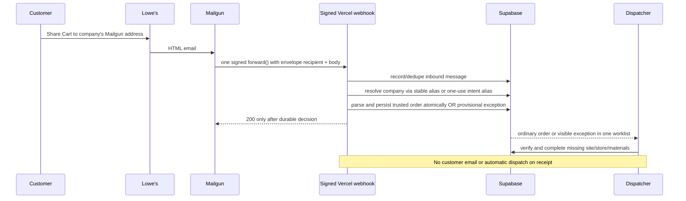

# 05 — Lowe's email intake

A customer builds a Lowe's cart and uses Lowe's **Share Cart** to send it to their company's address on the prototype Mailgun receiving domain. The application parses it into dispatcher work. A portal visit is **optional**.

> **Status:** The parser and signed webhook exist, but the temporary domain's receiving MX and a real Mailgun → Vercel delivery have **not been verified**. Do not represent the address as live until the operator has confirmed the receiving path and set `ORDER_INTAKE_READY=true`. One-use portal addresses, atomic persistence and inbound exception handling are later review phases; this document distinguishes today's code from that target.

## The critical detail: the sender is the retailer, not the customer

The captured Lowe's message has a generic subject and `From: Lowe’s Home Improvement <lowes@e.lowes.com>`. Its body contains `Sent from the cart of <requester email>`, three product names, Lowe's item/model numbers and quantities. It has **no prices, job-site address, store or aisle**. The company's identity comes from the SMTP **envelope recipient** in Mailgun's `recipient` field, not the retailer's sender, a displayed `To:` header or an inferred address. The requester email in the body is informational, not proof of ownership.

## Addressing and prerequisites

- **Email-only entry:** the pilot company retains its existing `companies.order_alias` local part (`things.dispatch+acme-construction`). Its customer-facing address is `<company.order_alias>@<ORDER_ALIAS_DOMAIN>`. It is a **Mailgun-domain** address, not the old `@gmail.com` inbox. You may give it to the customer without requiring portal login.
- **Optional portal (next phase):** generate `cart-<opaque random token>@<ORDER_ALIAS_DOMAIN>` for each `order_intents` row. The first eligible distinct email claims that intent's store and delivery site. A later *different* email to the same token is a new company order **without** the old site/store. Sending to the stable company alias never auto-matches the most recent intent.
- **The prototype domain is already verified for ownership, but its receiving MX is not yet confirmed.** In the user's Mailgun account, configure MX using the exact records provided by Mailgun for that domain, confirm inbound delivery, then the route and Vercel destination. `ORDER_INTAKE_READY=true` is an **operator confirmation**, not an automated DNS probe. `MAILGUN_SIGNING_KEY` is the HTTP webhook signing key, never the Mailgun API key.
- **Stable HTTPS URL:** Mailgun must reach the Vercel deployment from the public internet. Check Vercel deployment protection: a protected preview can reject provider POSTs before the Next.js route runs. Use a stable, reachable endpoint; if a preview bypass is required, manage its secret out of the repo.

See [11-deployment-and-environments](11-deployment-and-environments.md#temporary-mailgun-receiving-setup) for the user-run setup and later account handoff.

## Mailgun route configuration

Use **one** route scoped to the exact receiving domain. Its required action is:

```text
Expression: match_recipient("^.+@<receiving-domain-escaped-for-regex>$")
Action: forward("https://<stable-vercel-host>/api/webhooks/mailgun/inbound")
Optional additional action: store()
```

In the real route, replace the placeholder with the actual domain and escape dots for Mailgun's regular expression. `forward()` delivers the **parsed email** (typically form-encoded; multipart if attachments are present). Optional `store()` retains a recoverable copy at Mailgun for its plan-dependent limited retention. **Never configure `store(notify=".../api/webhooks/mailgun/inbound")`**: it sends a *different notification payload* to the same route and can be misinterpreted as a cart. A future storage-notification handler, if needed, gets its own endpoint. Avoid a callback URL ending in `json` or `mime` unless the route is deliberately updated to handle that format and its distinct signature rules.

Do not point a second Mailgun route at the same recipient and handler without confirming its behavior. One signed forward per incoming recipient is the acceptance contract.

## Webhook contract and current gaps

| Concern | Current code | Required before declaring live |
|---|---|---|
| Endpoint | `POST /api/webhooks/mailgun/inbound`, `web/app/api/webhooks/mailgun/inbound/route.ts` | Capture and test a **real** Mailgun form payload, not just a Gmail-exported `.eml` |
| Signature | HMAC-SHA256 of timestamp + token using `MAILGUN_SIGNING_KEY`; 406 on mismatch | Verify current account key and retry/timestamp behavior. Never log the key, token or raw body |
| Recipient | `lib/intake/process-inbound-email.ts` currently looks up the local part in `companies.order_alias` | Validate the recipient **domain** and use the current/legacy account's correct key; implement opaque intent tokens |
| Idempotency | Uses the email's `Message-ID` (legacy column name `mailgun_message_id`) or a content hash | Include recipient so the same Message-ID addressed to two companies does not suppress one of them; atomically handle retries |
| Retailer authenticity | Checks only for a `DKIM-Signature d=` header | Presence is **forgeable**, not verified authentication. Quarantine uncertain messages visibly; validate provider evidence with a real signed capture |
| Persistence | Records inbound email, attempt, order, items, intent and state in separate calls | Check every write and finalize related records transactionally so retries cannot strand half-orders |
| Customer email | No actual sending or checkout destination exists | **No automatic customer email or driver dispatch** in this intake milestone |

The current route accepts `formData` and calls the processor inline. Do not assume tests using `fake-supabase.ts` prove real Postgres/RLS behavior. For permanent invalid requests (e.g. bad signature) return 406 without creating an order; for transient persistence failures return a retryable 5xx; return 200 only after a durable decision. Mailgun's `store(notify=…)` is not a fallback for an unverified/blocked `forward()` endpoint.

## Signature verification

A Mailgun signature authenticates **Mailgun's POST**, not the author of the retailer email. The form payload's HMAC uses `timestamp + token`, not the HTML body. Treat a malformed or expired signature as invalid, but test the timestamp window against actual retries before relying on it for recovery. A token cache must not reject Mailgun's legitimate retry of a delivery that failed to commit.

For the retailer, a displayed From address or `DKIM-Signature d=` is **not sufficient**. Mailgun can add `X-Mailgun-Dkim-Check-Result` when spam filtering is configured to *mark with MIME headers*, but `Pass` alone does not prove which domain signed and inbound headers may contain sender-supplied copies. Until a real payload and spoofed-header test establish reliable, aligned provider evidence, parse as a **read-only provisional preview**, then require an authorized dispatcher to approve it before creating an operational order.

## Processing flow (target)



Lowe's does not state a materials price, so **zero in the current schema means unknown, not a free order**. The dispatcher enters the materials estimate as part of review.

## Idempotency and intent matching

Mailgun retries and can redeliver. One `Message-ID` + **normalized envelope recipient** identifies a delivered message; absent Message-ID, use a documented stable recipient + content fingerprint. A retry of the same message must not create a second order. Two different messages to one consumed intent token must create distinct orders, with only the first eligible message carrying the intent's site/store. Never fall back to the company's "latest open" intent for mail sent directly to its stable alias. All order/items/intent-status/event writes should commit together, not claim success after partial Supabase writes.

## Sender authenticity and unknown aliases

An unknown company alias/token, unsupported sender, unverified retailer, or failed parse is a **visible dispatcher exception**, not a silently ignored message or an automatically dispatchable order. The current implementation stores some such messages with no order, but the existing dispatcher query only lists `orders` in `received`/`needs_review`; the unified exception view is pending. A dispatcher must manually verify a questionable message before accepting/attributing it. Never auto-create companies from inbound mail.

## Out of scope for this milestone

Home Depot and Ace parsers, scraping retailer sites, AI fallback, automatic customer receipt/checkout email, driver broadcasting and payments. The optional portal remains supported; it is no longer the only way to request a delivery.
