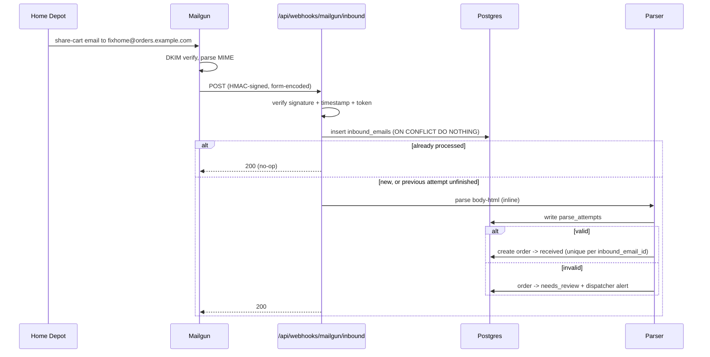

# 05 — Email Intake

How a customer's shared cart becomes a row in `inbound_emails`.

> **Status:** Implemented — `app/api/webhooks/mailgun/inbound/route.ts` and `lib/intake/`. No real mail flows yet: the domain prerequisite below is still outstanding, so the route is exercised by posting fixtures at it.

---

## The critical detail: the sender is the retailer, not the customer

This is the single most important fact about intake, and it is easy to get backwards.

When a customer uses Home Depot's "share cart" feature, **Home Depot sends the email**. The customer is not the sender — they are the subject line:

```
From:    The Home Depot <HomeDepot@order.homedepot.com>
To:      joe.haas@locksmithconsulting.com, notyetsoon@yahoo.com
Subject: Share Cart Invitation From Anthony Palumbi
```

Three consequences:

1. **We cannot attribute an order by sender address.** `order.homedepot.com` sends every customer's cart. Sender-matching would attribute every order to the same company.
2. **Attribution must come from the recipient.** This is exactly why the per-company alias decision is correct and not merely a convenience — it is the only reliable discriminator available. See [ADR-0008](../adr/0008-dispatcher-assigns-store.md) and [03-data-model](03-data-model.md#companies).
3. **The requester's name is in the subject**, in the form `Share Cart Invitation From <name>`.

A customer may also add our alias alongside other recipients, so our address can be one of several in the `To` header. The Mailgun webhook's `recipient` field reports the SMTP envelope recipient that matched our route, which is the value we key on — not the `To` header.

---

## Prerequisites

| # | Prerequisite | Blocks |
|---|---|---|
| 1 | Domain purchased | Everything below |
| 2 | Mailgun account | Everything below |
| 3 | Dedicated inbound subdomain (e.g. `orders.<domain>`) with MX records pointed at Mailgun | Inbound |
| 4 | SPF/DKIM records for outbound sending | Outbound deliverability |
| 5 | A **separate** subdomain for staging (e.g. `orders.staging.<domain>`) | Safe non-production testing |

Prerequisite 5 is not optional. Mailgun routes are scoped per domain, so sharing one domain across environments would deliver every real customer cart email into both production and staging.

---

## Alias scheme

```
<company.order_alias>@orders.<domain>
```

Example: a company with `order_alias = 'fixhome'` receives carts at `fixhome@orders.quickconstruction.example`.

The local part is stored on `companies.order_alias` as `citext` and is unique. The domain is configuration, not data — it lives in an environment variable so staging and production can differ without a migration.

The dispatcher creates the alias when onboarding a company. There is no self-service signup in the MVP.

---

## Mailgun route configuration

Two actions on one route:

```text
Priority: 0
Expression: match_recipient("(?P<alias>[^@]+)@orders\.example\.com")
Actions:
  store(notify="https://<app>/api/webhooks/mailgun/inbound")
  forward("https://<app>/api/webhooks/mailgun/inbound")
```

- **`store()`** retains the original MIME for 3 days, retrievable via the Messages API. This is the recovery path if our webhook is down or the payload is truncated.
- **`forward()`** POSTs the parsed message to us.
- **The named capture `alias`** is available for use in action URLs, but we re-derive it from the `recipient` field rather than trusting the URL, so a misconfigured route cannot silently misattribute orders.

A low-priority `catch_all()` route handles mail to unknown local parts — see [Unknown aliases](#unknown-aliases).

---

## Webhook contract

| Property         | Value                                                                                                                   |
|----------------|-----------------------------------------------------------------------------------------------------------------------|
| Endpoint         | `POST /api/webhooks/mailgun/inbound`                                                                                    |
| Content type     | `application/x-www-form-urlencoded`, or `multipart/form-data` when attachments are present                              |
| Authentication   | Mailgun HMAC signature — see below                                                                                      |
| Success response | `200` with the outcome as JSON — one of `parsed`, `needs_review`, `duplicate`, `unattributed`, `unsupported_retailer`, `not_authentic` |
| Failure response | `406` when the signature does not verify; `500` when our own work failed, so Mailgun retries a delivery we never recorded |
| Target latency   | Under Mailgun's timeout. The deterministic path is sub-second; the LLM fallback (when enabled) runs under a time budget |

### Payload fields we consume

| Field | Use |
|---|---|
| `recipient` | **Authoritative** — derive `recipient_alias` from this |
| `sender` | Retailer envelope sender |
| `from` | Retailer display address |
| `subject` | Requester name extraction |
| `body-html` | **The parser's input** |
| `body-plain` | Not used for parsing — Mailgun synthesizes it when only HTML exists, and the synthesis is lossy |
| `stripped-html` | Quoted-text-stripped variant; a useful cross-check when a customer forwards a cart inside a reply |
| `message-headers` | JSON header list; used for `Message-ID` and DKIM results |
| `timestamp`, `token`, `signature` | Request authentication |
| `attachment-count`, `attachment-N` | Counted and logged; cart emails have none |

### Signature verification

Mailgun signs every `forward()` request with HMAC-SHA256 over `timestamp` + `token` using the account's signing key. Reject unless the signature matches (constant-time comparison) **and** the timestamp is within five minutes of now.

Failure returns `406` and writes nothing.

**There is no single-use token store**, and that is deliberate rather than an oversight. Mailgun retries a delivery when the endpoint returns a non-2xx, and [ADR-0009](../adr/0009-inline-intake-and-cron-sweeps.md) makes those retries the recovery path for an email we failed to record. If a retry reuses its timestamp and token — which Mailgun documents neither way — a single-use check would reject exactly the retries the design depends on, and a real cart would be lost. Losing an order is worse than the replay window.

That leaves a residual hole worth naming: the signature covers the timestamp and token, **not the payload**, so a captured request could in principle be replayed with a different body inside the window. The window bounds it. Add the token store once Mailgun's retry behaviour is confirmed against a real account.

---

## Processing flow



Parsing runs **inline**, before the `200` is returned. The deterministic path is sub-second, so this costs nothing on the common path; a failure is recorded and lands in the review queue rather than being retried blindly.

### The order the checks run in

Each is cheaper than the one after it, and the order is deliberate:

1. **Record the raw email.** Always, before interpreting anything — that is what makes a parser fix replayable over history.
2. **Attribute it to a company**, from the recipient alias. The retailer sends every customer's cart from the same address, so the sender identifies nobody.
3. **Select a parser** by sender domain. No parser means **no order at all**, not even a `needs_review` one — the retailer value would be a guess. The email is still recorded.
4. **Require the retailer to have signed it** (see [Sender authenticity](#sender-authenticity)).
5. **Parse**, record the attempt, and create the order — `received` when it parsed, `needs_review` when it did not. The customer's cart is never silently dropped.

An **order intent** is claimed last, and only if it is still open, so two carts arriving together cannot both take the same store and address.

---

## Idempotency

Mailgun retries on non-2xx and can deliver duplicates. `inbound_emails.mailgun_message_id` is unique, and the insert relies on it.

**What that column actually holds:** the email's own `Message-ID` header. Mailgun's `forward()` payload carries **no message id of its own** — the documented fields are signature, timestamp, token, subject, sender, from, recipient, message-headers, and the bodies. The `Message-ID` is stable across a redelivery and unique per email, which is precisely what an idempotency key needs. A message without one falls back to a SHA-256 of its recipient, subject, and body, which is also stable across a redelivery.

The column name is a legacy of the assumption that Mailgun would supply one. It is the idempotency key, not a Mailgun identifier.

A retry is treated as **recovery, not a no-op**:

- If the existing row is already `parsed` or `needs_review`, the delivery is a duplicate — return `200` and do nothing.
- If the existing row is still `pending` or `failed` — a previous attempt did not finish — **re-process it**. A retry of a timed-out delivery is exactly the recovery path we want.

Order creation is idempotent on top of this: `orders.inbound_email_id` is unique, so two attempts on the same email cannot produce two orders. The second insert fails the constraint and returns `200`.

---

## Sender authenticity

Anyone can send mail to our alias, and a `From` header is free to forge. Two checks, in this order:

1. **Retailer identification by sender domain**, using a dot boundary — `host === domain || host.endsWith('.' + domain)`. A bare `endsWith("lowes.com")` would also accept `notlowes.com`, which is how a spoofed sender gets a parser applied to it. An unrecognised sender never selects a parser.
2. **A DKIM signature under that same domain.** The message must carry a `DKIM-Signature` whose `d=` is the parser's declared domain or a subdomain of it.

The second check is a **weak signal, deliberately and not by accident**: a `DKIM-Signature` header can itself be forged, so its presence is not proof. Verifying it properly means fetching the selector's public key from DNS and re-canonicalising the message, which is out of scope for the MVP. What it does establish is that the message was prepared by something that knows the retailer's DKIM conventions, which a casual forgery will not.

A message failing either check is stored with `processing_status = 'ignored'` and never becomes an order. The remaining defence is that a company's order alias is not public: an attacker has to know one to try at all.

A message that fails DKIM is stored with `processing_status = 'ignored'` for visibility but never becomes an order. This is the anti-spoofing boundary: without it, a crafted email could fabricate an order and a driver would be dispatched to buy materials with no legitimate cart behind it.

---

## Unknown aliases

If `recipient_alias` matches no company:

- The email is stored with `processing_status = 'needs_review'`.
- `order_id` stays null.
- It appears in the dispatcher console as an **unattributed inbound email**, where the dispatcher can either attach it to an existing company (creating the order) or dismiss it.

This is the safety net for typos, forwarded carts, and prospects who email us before being onboarded. It is deliberately not an auto-create: silently creating companies from unverified inbound mail is how a spam flood becomes a customer database.

---

## What is out of scope

- Attachment parsing. Cart emails are HTML-only; `attachment-count` is logged as a signal that the retailer changed their template.
- Inbound customer replies. Replies go to the portal, not to email. A reply to our alias lands in the unknown-alias queue rather than being interpreted.
- Spam filtering. Mailgun's edge filtering plus DKIM verification is the MVP posture.
