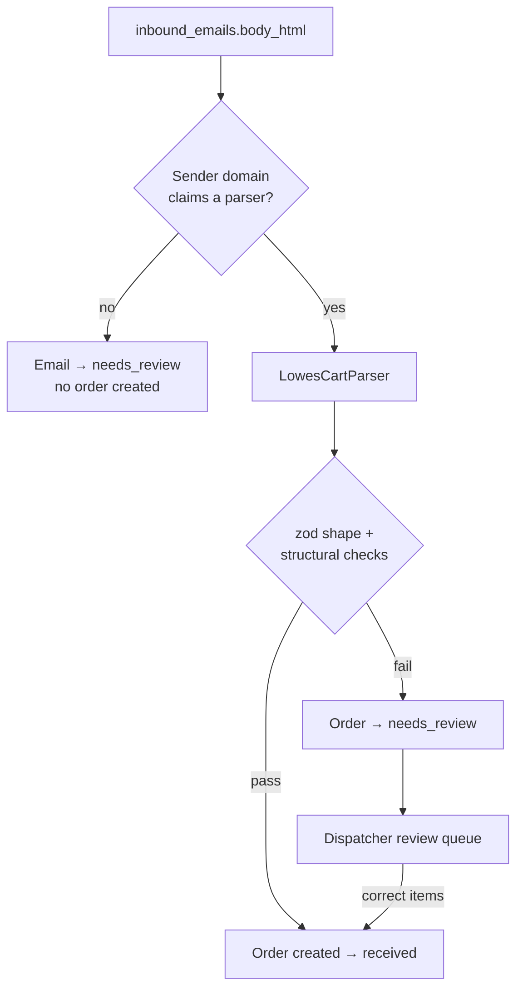

# 06 — Cart Parsing

Turning a retailer's share-cart email into validated line items.

> **Status:** Implemented for **Lowe's** (`web/lib/parsers/`). Home Depot is a deferred retailer — its field map is kept below as a reference appendix and no parser is being built for it. The LLM tier is an interface with no implementation. Depends on [05-email-intake](05-email-intake.md).

---

## Approach

A deterministic HTML parser per retailer, with a human backstop. The LLM tier is deferred.



Parsing runs **inline** in the webhook request — it is sub-second HTML extraction. A failure is recorded in `parse_attempts` and lands in the review queue rather than being retried blindly. See [ADR-0009](../adr/0009-inline-intake-and-cron-sweeps.md).

**Every attempt is recorded in `parse_attempts`** with strategy, parser version, output, and errors. Silent drift is the failure mode being guarded against: a retailer changing their markup would otherwise quietly produce wrong orders.

---

## Why deterministic first

The Lowe's sample contains every field we need, in stable, identifiable markup. Sending it to an LLM would mean paying per email, accepting non-determinism, and adding a vendor to solve a problem that is already solved.

The LLM tier exists for the cases we *cannot* enumerate — not as the primary path. See [ADR-0004](../adr/0004-deterministic-parser-with-llm-fallback.md).

---

## Parser interface

`web/lib/parsers/types.ts`. A parser is a pure function over an email — no database, no webhook, no caller — which is what makes it testable against a committed fixture.

```ts
interface CartParser {
  readonly retailer: Retailer;
  readonly version: string;              // 'lowes@1.0.0'
  matches(senderDomain: string): boolean;
  parse(input: ParseInput): ParseResult;
}

type ParseInput = { bodyHtml: string; subject: string | null; senderEmail: string };

type ParseResult =
  | { ok: true; data: ParsedCart; signals: ParseSignals; warnings: string[] }
  | { ok: false; reason: string; partial?: unknown };
```

A parser that throws is a bug; `ok: false` is an expected outcome. Failures are data.

### Retailer is identified by sender domain

Never by the recipient, and never by anything in the body. The retailer sends the email, so the domain is the only field a customer cannot influence. Attribution to a company happens separately, from the recipient alias — see [05-email-intake](05-email-intake.md).

Domain matching uses a **dot boundary**: `host === domain || host.endsWith('.' + domain)`. A bare `endsWith("lowes.com")` would also accept `notlowes.com`, handing a spoofed sender a parser. `lowes.com` as the parent still admits `e.lowes.com` (the observed sender) and the apex.

---

## Lowe's field map

Derived from a real share-cart email: **3 items**, which is what confirmed the parser handles more than a single row.

| Field | Location |
|---|---|
| Requester email | Body text `Sent from the cart of <address>` |
| Item blocks | `<td align="center">` containing `table.container` |
| Product image | `td[width="100"]` → `img[src*="mobileimages.lowes.com"]` |
| Name | the `<strong>` inside the product anchor |
| Item # and Model # | one text node: `Item: #552328 \| Model: #Y2L40408-GC` |
| Quantity | `<strong>Quantity 3</strong>` |

### Details that matter

**The image host is the item anchor.** Product images come from `mobileimages.lowes.com`. The other image host in the email, `image.e.lowes.com`, holds the logo and a hundred one-pixel spacer gifs — matching on it would produce a cart of hundreds of blank items.

**Name and quantity are both `<strong>`.** So is the product name. Match the name by *structure* (a `<strong>` inside an anchor) and the quantity by *content* (`^Quantity \d+$`). Never by tag alone, and never by position.

**Scope each block to its own container.** `img.closest("table.container")` keeps one item's fields from bleeding into the next. Without it, a regex over the whole document would take the first quantity for every item.

### What the email does not carry

| Absent | Consequence |
|---|---|
| **Any price at all** — no line totals, no subtotal, no tax, not one `$` | Nothing to reconcile against. Validation is structural instead, and the dispatcher enters the materials cost by hand |
| Store, aisle, bay | The customer captures the store before building the cart — [ADR-0010](../adr/0010-customer-captures-store-and-address.md) |
| Requester name | The subject is generic (`Check out this Lowe's shopping cart.`) and the body gives an address, not a name |
| A cart URL | The only links are `click.e.lowes.com` tracking redirects |

The subject contains a **curly apostrophe** (`Lowe’s`, U+2019) and arrives RFC 2047-encoded. Nothing should assume ASCII.

---

## Validation

Two layers, and only the first is universal.

### Shape — `zod`

`ParsedCartSchema` in `web/lib/parsers/schema.ts`. Deliberately permissive about what cannot make an order wrong (a missing image URL, an absent brand) and strict about what can (an empty description, a zero quantity).

`lineTotalCents`, `unitPriceCents`, and `totals` are **nullable**. A missing price must never be mistaken for a price of zero — that is the whole reason Lowe's works at all.

### Semantics — the checks a schema cannot express

| Check | Rationale |
|---|---|
| **Three independently-derived item counts agree** | `Item: #` markers, `Quantity N` markers, and product-image paths — none of them by walking the blocks the parser walks. Agreement is evidence; the block walk agreeing with itself would not be. This is the structural stand-in for reconciliation |
| **No two items share an identifier** | A repeated `Item #` means a block was matched twice — **which is how a duplicated view would look**. The email carries no totals, so nothing else would catch a doubled cart |
| `Σ lineTotalCents === subtotalCents` (±1¢) | Runs **only when the retailer stated totals**. Lowe's does not; Home Depot does |
| `estimatedTotalCents === subtotal + shipping + tax` | As above |

A cart that fails any of these is a **parse failure**, not a warning.

### The honest weakness

Structural validation is weaker than arithmetic. With no subtotal, a cart that is doubled *and* consistent across all three counts would pass — the duplicate-identifier check is what catches it, which is why it is not optional. The review queue is the backstop behind that.

---

## Review queue

When parsing fails, the order is created in `needs_review` and surfaces in the dispatcher console with the email beside an editable item table.

The dispatcher corrects the items and the order advances. This is the only manual item-entry path — and the order still originates from a real email.

The manual path writes a `parse_attempts` row with `strategy = 'manual'`, so we can measure how often automation actually succeeds.

---

## LLM fallback — deferred

| Aspect | Rule |
|---|---|
| Trigger | The deterministic parser returned `ok: false`, or its output failed validation |
| Input | `bodyHtml` with `<style>`, `<script>`, comments, and tracking URLs stripped; truncated to a budget |
| Output | JSON conforming to `ParsedCartSchema` |
| Validation | **Identical** to the deterministic path |
| On failure | Order → `needs_review`; never a partially-populated order |

The hook is the `CartParser` interface and the shared schema: the tier is an implementation of the interface, nothing more. `parse_attempts.strategy` already has an `llm` value, and migration `0004` removed the constraint that would have blocked a second attempt per email. See [12-deferred](12-deferred-and-extension-points.md#llm-fallback-tier).

An LLM response would never be trusted on its own — it is a candidate that must satisfy the same checks.

---

## Testing

`bun test`. Fixtures live in `web/lib/parsers/__fixtures__/`.

| Fixture | Status |
|---|---|
| `lowes/multi-item.eml` | **Committed** — a real 3-item cart |
| `lowes/empty-cart.eml` | Needed |
| `homedepot/*.eml` | **Reference only** — the two samples stay in `External Notes/` until that parser is built |

**Fixtures are `.eml`, not `.html`,** so a test exercises the whole input path — headers, transfer encoding, body — and cannot drift from what the customer actually produced. `__fixtures__/read-eml.ts` does the MIME work. **None of it ships:** Mailgun decodes MIME at its edge and hands the webhook already-separated fields. Two quirks in that helper are real rather than hypothetical — Lowe's folds the `From` header so the address sits on a continuation line, and RFC 2047-encodes the display name.

What the suite asserts:

- The captured cart parses to exact item numbers, model numbers, quantities, names, and image URLs
- No money is invented — `totals` and every line total are `null`
- The three counts agree, and the parser produced as many items as they claim
- A cart whose blocks repeat is **rejected** (the duplicated-view guard)
- A cart whose counts disagree is **rejected**
- A block missing its identifier, or its quantity, is **rejected**
- A body with no items is **rejected**
- Sender matching accepts `e.lowes.com` and rejects `notlowes.com`

**Replay tests.** `inbound_emails.body_html` is retained, so any historical email can be re-parsed against a new parser version. That is how a parser fix is proven not to regress older carts.

---

## Parser versioning

Version strings (`lowes@1.0.0`) are recorded on every `parse_attempts` row. When a retailer changes their markup:

1. A drift signal fires from the failure rate.
2. A new fixture is captured and the parser is bumped.
3. Replay tests confirm old emails still parse.
4. The new version ships; the failure rate is confirmed back to zero.

Without versioning, "parsing broke last Tuesday" is unanswerable.

---

## Known unknowns

1. **One full Lowe's `.eml` plus a redacted structural excerpt from a second pilot cart.** Both exercise three lines and unknown prices; the excerpt is not a full Mailgun form capture. A different item count and additional full, sanitized templates would strengthen drift detection. This improves parsing confidence, not retailer authentication.
2. **No prices means no arithmetic check.** See [the honest weakness](#the-honest-weakness) above. Structural checks plus the duplicate guard plus the review queue are the whole defence.
3. **Home Depot's multi-item structure was never observed.** Both samples hold exactly one item, so its row repetition is inferred. Moot while Home Depot is deferred, but it must be re-established rather than assumed if that parser is built.

---

## Appendix: Home Depot field map (reference)

Kept because the analysis is done and the samples exist. **No parser is being built for this retailer.** Verified against two real samples.

| Field | Location | Notes |
|---|---|---|
| Requester name | Email `Subject` | `Share Cart Invitation From (.+)` |
| Item list root | `table.desktop_item_list` | |
| Item rows | `tr` within it containing `img[alt="Product Image"]` | Row-relative, not positional |
| Brand | the `<b>` inside the product anchor | |
| Model # / Store SKU # | `Model\s*#(\S+)` and `Store SKU\s*#(\S+)` in the product cell | Model numbers are **not all numeric** — `9988872` and `GRCR3DGAL` |
| Aisle / Bay | **inside the `width:150px` cell** — a nested `td` beside `img[alt="pin"]` | Labels always present; values populated in one sample, empty in the other |
| Quantity / Line total | direct child `td`s with `width:62px` and `width:78px` | |
| Totals | `table.sub-total-view.hide_mobile_view`, pairing `span.total-heading` with the adjacent value | Subtotal, Shipping, Sales Tax, Est. Total |

**The duplicate-view trap.** Home Depot builds for desktop *and* mobile and ships the cart twice — `hide_mobile_view desktop_item_list` (visible) and `visible_mobile_view mobile_item_list` (`display:none`), with totals duplicated the same way. Parse only `hide_mobile_view` subtrees, or every order doubles. **Lowe's does not do this** — each item appears once — so the rule is Home Depot's, not a general one.

**Row structure:**

```
<tr>
  <td>                          <!-- product: nested table with image + name + model + sku + aisle/bay -->
  <td style="…width:150px">     <!-- "In Store" column: nested td with pin icon + Aisle/Bay -->
  <td style="…width:62px">      <!-- quantity -->
  <td style="…width:78px">      <!-- line total -->
</tr>
```

`width:150px` also appears on the *header* row, so match the cell within an item row rather than globally.

**Derived field.** `unit_price_cents` is not in the email — only a per-line `Item Total`. Unit price is `line_total / quantity`, display-only; the line total is authoritative.
