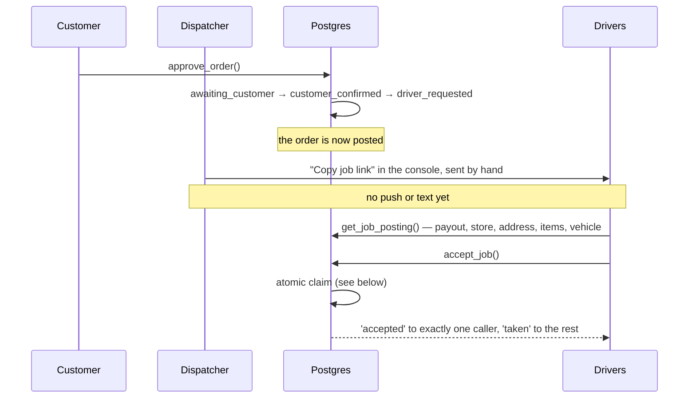

# 07 — Dispatch

Posting an approved order to drivers and resolving the race when several accept.

> **Status (2026-11-18):** Built: automatic posting when the customer approves, the job board, posting details, first-accept-wins (`accept_job`), Release driver, and receipt and delivery photos. Not built: Decline (planned for the pilot), push notifications (planned), texts (later), and the expiry sweep. See [04-order-lifecycle](04-order-lifecycle.md) for the transitions.

---

## Flow



Posting happens the moment the customer approves; the dispatcher does not post by hand. **Planned:** once payment at approval is built, posting happens when the payment clears instead (decided 2026-11-18). Push to drivers on a new job is planned; texts come later.

---

## Postings, not offers

A `driver_requested` order **is** the posting. Every active driver sees every open posting on the job board; there is no per-driver offer row and no per-driver offer status.

This is a deliberate simplification for the MVP's scale (a handful of companies, a few drivers):

- The board is a query over `orders` in `driver_requested` (`get_open_jobs_for_driver()`, open to drivers and dispatchers), not a table of offers.
- The only dispatch state that matters — who has the job — lives in one place: `orders.assigned_driver_id`.
- The one per-driver fact worth keeping is a decline, recorded as a plain row ([below](#declines)) rather than as a status.

If targeted dispatch (per-driver offers, geographic or vehicle filtering) is ever needed, it can be added then. Nothing about `orders` changes.

---

## What a driver sees

| When              | What the posting shows                                                                 |
| ----------------- | -------------------------------------------------------------------------------------- |
| Before accepting  | Payout, store, the full delivery address, items, and the vehicle needed (Car or Truck) |
| After accepting   | Also the on-site contact (name and phone) and drop-off instructions                    |

`get_job_posting()` returns the posting; drivers cannot select an order directly until they have accepted it.

The Jobs page lists **In progress**, **Open jobs** and **Delivered**.

---

## Eligibility

Every active driver (`profiles.role = 'driver'` and `profiles.active = true`) sees every open posting. Nobody is alerted today; the dispatcher sends the job link by hand. **Planned:** a push notification to every driver with notifications turned on.

The MVP has a single market (Greenville/Spartanburg, SC), so there is no geographic filtering. When a second market is added, an eligibility predicate on `retailer_stores` location is the natural extension point.

---

## First-accept-wins

This is the only genuine concurrency hazard in the system, and it is settled by the state transition itself.

Acceptance is the `driver_requested → driver_assigned` transition, done by `accept_job()`. The whole claim is one conditional statement:

```sql
update orders
   set assigned_driver_id = $driver, status = 'driver_assigned', updated_at = now()
 where id = $order
   and status = 'driver_requested'
   and assigned_driver_id is null
returning id;
```

Postgres re-evaluates the predicate after the row lock is released, so the loser matches zero rows and gets `'taken'`. Application-level checks (`SELECT` then `UPDATE`) are not sufficient — the guard lives in the function.

`accept_job()` is the only code that sets `orders.assigned_driver_id`; `release_driver()` clears it.

Guard: the caller is an active driver, the order is `driver_requested`, and no driver is assigned. A retried Accept from the winner (double-tap, network retry) returns `'accepted'` rather than an error. The payout is locked once a driver accepts.

---

## Declines

**Not built.** The `job_declines` table exists, but nothing writes to it yet. Planned for the pilot (decided 2026-11-18): a **Decline** button on the driver's job page that inserts one row:

```
job_declines
  id, order_id FK, driver_id FK, reason text null, created_at
  UNIQUE (order_id, driver_id)
```

- A decline does not change the order's status and does not affect other drivers.
- The posting disappears from that driver's board — `get_open_jobs_for_driver()` already excludes orders the caller has declined.
- When every active driver has declined, the order moves to the top of the dispatcher's **Finding driver** tab, marked **All drivers declined**. Once push exists, dispatchers also get a notification. The dispatcher handles it from there, by calling a driver or the customer.

A decline has no concurrency hazard — the insert is idempotent via the unique constraint.

---

## Broadcast expiry

**Not built** (there are no cron jobs). The design: a sweep looks for orders still `driver_requested` past a time limit and warns the dispatcher once per order. The MVP does **not** auto-rebroadcast — an unfilled order is a signal a human should see. This longer "sat unaccepted too long" warning is separate from the planned All drivers declined flag.

---

## Withdrawal and reassignment

| Action                             | Effect                                                                                          | Status |
| ---------------------------------- | ----------------------------------------------------------------------------------------------- | ------ |
| Assigned driver falls through      | Dispatcher clicks **Release driver** (`release_driver()`) at any step before delivery. The order returns to `driver_requested` and is posted again; photos already taken stay, and the payout unlocks | Built |
| Driver declines                    | A `job_declines` row. The order stays `driver_requested`; other drivers are unaffected          | Planned for the pilot |
| Dispatcher withdraws the posting   | The posting leaves every board                                                                  | Not built |
| Order cancelled                    | The posting leaves every board                                                                  | Not built |

Status changes are recorded in `order_status_events`; a release records the released driver. There is no separate offer record to reconcile.

---

## After accepting

The driver moves the job forward one step at a time with `advance_job()` (forward only): **I'm at the store** → **Items purchased** (receipt photo, or skip with a reason) → **On my way** → **Delivered** (delivery photo, or skip with a reason). Photos upload from the phone straight to the private `evidence` bucket. The dispatcher sees each step's time, the photos and any skip reason; the customer sees delivery progress and the delivery photo only. `delivered` is the last step today.

---

## What is out of scope

- Automatic re-broadcast on expiry
- Targeted or filtered dispatch (per-driver offers)
- Driver ratings or reliability scoring affecting eligibility
- Distance-based or vehicle-capacity matching
- Scheduled or batched dispatch
- Driver payouts (see [12-deferred-and-extension-points](12-deferred-and-extension-points.md))
