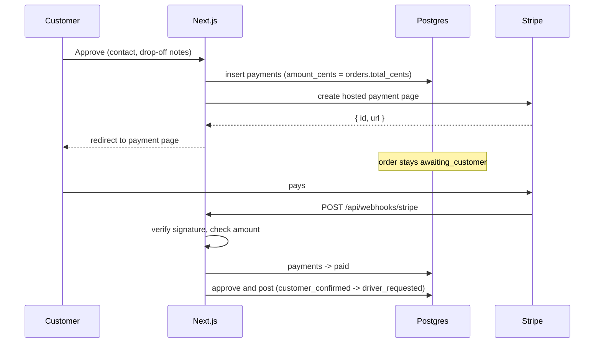

# 09 — Payments

Collecting the delivery total when the customer approves the order.

> **Status:** Planned, not built yet. Decided 2026-11-18: the customer pays at approval, not after delivery. A teammate (Stephen) is setting up the payment processor account. See [ADR-0011](../adr/0011-pay-on-approval.md), which replaces the pay-after-delivery timing in [ADR-0006](../adr/0006-stripe-payment-links.md).

Today nothing is charged. `approve_order` records `customer_confirmed` and posts the order to drivers (`driver_requested`) at once. The `payments` table and the `payment_status` enum exist in the baseline schema but nothing writes to them.

---

## Planned flow

Approving takes the customer to pay. The order stays `awaiting_customer` until the payment clears. Only a cleared payment approves the order and posts it to drivers.



Stripe is the documented processor. Whether to use Payment Links or Checkout Sessions will be decided when this is built. The customer is present at approval, which suits a session-style checkout.

---

## Amount authority

**`orders.total_cents` is the single source of truth for the amount charged.** The dispatcher's quote sets it:

```
total_cents = materials_subtotal_cents
            + sizing_fee_cents
            + mileage_fee_cents
            + tax_cents
            - discount_cents
```

The driver payout is not part of `total_cents`. Whether tax or a discount applies is still open.

The payment is created for that exact value, and `payments.amount_cents` stores it. The webhook compares the paid amount against `payments.amount_cents`. A mismatch is a reconciliation alert: it does **not** approve the order.

---

## Webhook (planned)

| Property     | Value                                                         |
|--------------|---------------------------------------------------------------|
| Endpoint     | `POST /api/webhooks/stripe`                                   |
| Verification | Stripe signature header, verified against the endpoint secret |
| Response     | `200` after the event is processed                            |

Handling:

1. Verify the signature. Reject unsigned or invalid requests with `400`.
2. Look up `payments` by `stripe_session_id` (unique). If absent, log and return `200`.
3. If already `paid`, return `200`. Stripe retries, so this must be a no-op.
4. Compare the paid amount against `payments.amount_cents`. A mismatch is flagged and does not approve the order.
5. Mark `payments` → `paid`, then approve the order and post it to drivers.

The unique `payments.stripe_session_id` is what makes step 3 safe under Stripe's at-least-once delivery.

---

## Keys and environments (planned)

Test-mode keys everywhere except production, which uses live keys. Each webhook endpoint has its own signing secret. The app should check that the key's mode matches the environment at startup, so a test link never reaches a real customer and a live key never charges from a test environment.

---

## Still open

- Payment Links or Checkout Sessions.
- Whether tax or a discount applies.
- A receipt for the customer.
- What happens when a payment fails or the customer leaves the payment page.
- Approving on a customer's behalf now means the dispatcher taking payment for a customer who calls in. Pilot customers approve and pay themselves.

## Out of scope

- Refunds and partial refunds (the `refunded` status exists in the enum; no UI).
- Driver payouts through the processor (Stripe Connect). That needs driver KYC and tax handling.
- Subscription or prepaid billing.
- Storing cards or building our own card form. Payment stays on a Stripe-hosted page, so card data never touches our servers.
- Tips.
