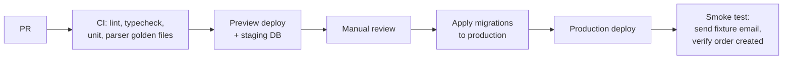

# 11 — Deployment & Environments

Environments, configuration, prerequisites, and the release process.

> **Status:** Prototype intake code exists. The team has reported applying migrations through `0006`; confirm the target database's migration history before applying new ones. Receiving MX and a real Mailgun → Vercel delivery have not been verified. Mailgun/DNS/Vercel account changes are user-operated.

---

## Environments

|                  | Local                         | Preview / Staging         | Production                   |
| ---------------- | ----------------------------- | ------------------------- | ---------------------------- |
| App              | `next dev`                    | Vercel preview deploy     | Vercel production            |
| Database         | Supabase CLI (local Postgres) | Staging Supabase project  | Production Supabase project  |
| Inbound email    | Signed fixture requests      | Your verified temporary receiving domain + MX | Client's verified receiving domain + MX |
| Outbound email   | Not implemented               | Not implemented           | Not implemented in this intake milestone |
| SMS              | Twilio test credentials       | Twilio test credentials   | Twilio live                  |
| Payments         | Stripe test                   | Stripe test               | Stripe live                  |
| Scheduled sweeps | Call the cron routes manually | Manual (cron disabled)    | Vercel Cron                  |

### Why staging needs its own email subdomain

Mailgun routes are scoped to a **receiving domain**. For the prototype, use your verified temporary domain and route to one stable Vercel deployment. When the client's account comes online, use a separate receiving domain and account key. Do not configure two callbacks for one email or reuse a receiving domain across independent deployments: you would create duplicate or misattributed orders.

Keeping the old prototype domain live for a short overlap requires **explicit support for its separate webhook signing key**. That dual-account support is a later implementation phase; do not treat a second environment variable alone as proof that the app accepts the old domain.

---

## Prerequisites checklist

This list mixes immediate receiving prerequisites with later delivery systems. **Only the verified inbound domain/MX, reachable signed callback, and applied intake schema block the live mail-to-dispatcher milestone.** Outbound, payments and driver SMS are separate projects.

| #   | Item                                          | Owner | Notes                                        |
| --- | --------------------------------------------- | ----- | -------------------------------------------- |
| 1   | **Your verified receiving domain** — available | You | Confirm the intended subdomain in your temporary Mailgun account |
| 2   | **Your temporary Mailgun account** — available | You | Use the HTTP webhook signing key, not the API key |
| 3   | **Receiving MX** — not confirmed | You | Install and verify Mailgun-provided records for that domain |
| 4   | **Outbound SPF/DKIM** — deferred | You | Only needed once real customer email sending exists |
| 5   | **Client receiving domain** — later | Client | New domain and account; overlap requires dual signing keys in app |
| 6   | **One Mailgun forward route** | You | Parsed `forward()` to the webhook; optional `store()` without `notify` |
| 7   | Webhook signing key in Vercel config          | You | Do not log or commit it |
| 8   | Supabase project and schema                   | You | Reported applied through `0006`; verify before applying `0007` |
| 9   | Separate Supabase staging project             | You | Recommended for live acceptance without production data |
| 10  | **Stable public Vercel deployment**           | You | Check deployment protection does not block provider POSTs |
| 11  | **Stripe account**                            |       |                                              |
| 12  | Stripe webhook endpoints (per environment)    |       |                                              |
| 13  | **Twilio account** + sender number            |       | A2P registration may take days — start early |
| 14  | Vercel Cron schedule configured               |       | Notifications outbox + broadcast expiry      |
| 15  | LLM provider API key                          |       | Deferred; deterministic Lowe's parser is the prototype path |
| 16  | North Carolina Lowe's store list              |       | Pilot seed already exists; confirm stores relevant to the pilot site |

Item 13 deserves emphasis: US A2P 10DLC registration is not instant. Starting it late blocks driver SMS, which blocks dispatch.

---

## Configuration

All configuration is environment variables. No secrets in the repo, no `.env` files committed.

```bash
# Supabase
# Project Settings → API Keys → "Publishable and secret API keys". The publishable
# and secret keys replace the legacy anon / service_role JWTs, which Supabase
# deprecates at the end of 2026. Both are opaque strings, not JWTs.
NEXT_PUBLIC_SUPABASE_URL=               # https://<project-ref>.supabase.co
NEXT_PUBLIC_SUPABASE_PUBLISHABLE_KEY=   # sb_publishable_...  browser-safe; RLS applies
SUPABASE_SECRET_KEY=                    # sb_secret_...  server-only, never NEXT_PUBLIC_; bypasses RLS

# Mailgun
MAILGUN_API_KEY=                    # outbound sending + the Messages API
MAILGUN_SIGNING_KEY=                # inbound webhook verification (HMAC)
MAILGUN_DOMAIN=                     # outbound sending domain
ORDER_ALIAS_DOMAIN=                 # your temporary verified inbound domain, never gmail.com
ORDER_INTAKE_READY=false            # set true only after YOU verify receiving MX, one forward(), and public Vercel callback

# Twilio
TWILIO_ACCOUNT_SID=
TWILIO_AUTH_TOKEN=
TWILIO_FROM_NUMBER=

# Stripe
STRIPE_SECRET_KEY=
STRIPE_WEBHOOK_SECRET=

# Cron sweeps
CRON_SECRET=                        # shared secret for /api/cron/* requests

# LLM fallback
LLM_API_KEY=
LLM_MODEL=

# App
APP_URL=
APP_ENV=local|preview|production
```

Two guardrails:

- **`SUPABASE_SECRET_KEY` is never prefixed `NEXT_PUBLIC_`.** A `NEXT_PUBLIC_` prefix ships a value to the browser; this key bypasses all RLS. The legacy `service_role` key had the same property — the rename does not change the rule.
- **The app asserts `APP_ENV` against key modes at startup.** A `sk_live_` Stripe key with `APP_ENV=preview` is a misconfiguration that would charge real customers from a test environment. Fail fast instead.

## Temporary Mailgun receiving setup

This is an **operator-run** checklist. Do not put keys, real webhook URLs with protection bypass secrets, or customer emails in source control or chat.

1. Confirm which **verified domain/subdomain** in your Mailgun account will receive Lowe's carts. Install the **MX records shown in your account** for that receiving domain. Domain ownership verification alone does not establish inbound delivery. Send an external test email to a controlled recipient on that domain and confirm Mailgun received it.
2. Deploy the Next.js app to a **stable public Vercel HTTPS host**. Confirm its `/api/webhooks/mailgun/inbound` endpoint is reachable by Mailgun. If the deployment is protected, configure a provider-compatible Vercel bypass out of band or use a suitable public deployment. The Mailgun HMAC still authenticates the actual POST.
3. Configure one Mailgun **Forward** recipient pattern `delivery*@mg.getlockstep.io` for the shared `delivery@` and new `delivery+<token>@` pilot addresses, forwarding to `https://<stable-app-host>/api/webhooks/mailgun/inbound`. To receive existing company-specific or old `cart-<token>` addresses too, use `*@mg.getlockstep.io` instead (or non-overlapping separate rules). Do not let rules overlap and forward twice. Optional storage notifications must **not** point at that URL: they are not parsed cart form data. Keep the callback URL free of `json`/`mime` suffixes.
4. In Vercel, set the server-only `MAILGUN_SIGNING_KEY` to that account's **HTTP webhook signing key**, `ORDER_ALIAS_DOMAIN` to the receiving domain, and the Supabase server/browser keys required by the app. `MAILGUN_API_KEY` and `MAILGUN_DOMAIN` are outbound/storage API settings; they do not replace the webhook signing key. Do not display an address as live yet.
5. Verify one signed Mailgun `forward()` arrives with the **SMTP envelope recipient, message headers, HTML body, and an acceptable HTTP status**. Record only safe status/identifiers in logs, not secrets or raw customer email. The user has tested both the shared address and an order-specific `delivery+` address through provisional review and approval after applying `0009`/`0010`. `ORDER_INTAKE_READY` controls which addresses the portal advertises, not whether the webhook accepts mail; keep it limited to the controlled pilot. Migration `0011` must be applied before testing new dispatcher delivery/store/quote save forms. Do not assume the extra redacted test excerpt proves every Lowe's template. No outbound customer message is sent on receipt.

The `.eml` fixture and fake Supabase tests do not prove real Mailgun retries or concurrent intent claims. The first shared-address email succeeded; the new optional portal address requires applied migrations through `0010` and a live token-address test before customer use. See [05-email-intake](05-email-intake.md).

### Swapping the Mailgun account

**The client uses a new domain.** Keeping the company's existing local part means its full address still changes, so tell customers and preserve a short period in which the old address is accepted for in-flight carts. Never assume changing `MAILGUN_SIGNING_KEY` and `ORDER_ALIAS_DOMAIN` alone is an overlap strategy: Mailgun keys are per account.

1. Before switching, ship and test **domain-to-key pairing** for both old and new inbound domains, with no fallback from the old domain to the new account's key. This dual-account handling is **not implemented yet**.
2. Have the client set up/verify their receiving domain and MX, and configure one `forward()` route to the same deployed endpoint. Test the new domain with a fresh cart before advertising it.
3. Put the client's domain/signing key into the **current** Vercel variables; keep the temporary domain/key in separate **legacy** variables during the overlap. Deploy and verify both routes. The portal shows only the client's domain; historical orders and incoming duplicate handling retain their recipient domain.
4. Communicate the address change. After a separately agreed grace period and a check that no in-flight carts still use the prototype domain, retire its Mailgun route and legacy key. Do **not** delete old email or queued notifications.

Outbound setup, verified sending domain, and a real customer-confirmation page are separate milestones; activating inbound does not activate outbound.

---

## Database migrations

Schema is versioned as numbered SQL files in `supabase/migrations/`, committed and reviewed like code. The pattern is Flyway-style: **a base script, then one file per change, applied in order.** Conventions in full in [03-data-model](03-data-model.md#migrations).

| File                | Purpose                                                                     |
| ------------------- | --------------------------------------------------------------------------- |
| `0001_baseline.sql` | The base script — the complete schema. Applied once per environment, frozen. |
| `0002_<change>.sql` | One incremental change.                                                      |
| `0003_<change>.sql` | …and so on.                                                                  |

Rules:

- **`0001_baseline.sql` is applied exactly once per environment**, to a database with no application schema. It is deliberately not idempotent: a second run fails on the first `create type`, which is the correct signal that migration state has been lost track of.
- **Never edit a migration that has been applied anywhere.** A fix, a new column, or a new policy is a new numbered file. Editing an applied file diverges environments silently.
- **No manual schema changes in the dashboard.** Ever. A dashboard change is invisible to the repo and diverges environments silently.
- **RLS policies are created in the same migration as the table they protect** — never as a follow-up.
- Applied with the Supabase CLI (`supabase db push` for staging, the same for production after review) or by hand in the SQL editor for the initial bootstrap.
- Seed data lives in `supabase/seed/`, is idempotent so it can be re-run safely, and is applied **after** migrations — never as part of them.

### Bootstrapping a new environment

1. Create the Supabase project (production: `us-east-1`).
2. Apply `supabase/migrations/0001_baseline.sql` — either paste it into the SQL editor, or link and push:

   ```bash
   supabase link --project-ref <ref>
   supabase db push
   ```

3. Verify RLS took: every table in `public` should report `rowsecurity = true` and carry at least one policy. A table with RLS on and no policy is inaccessible to everyone but the service role.
4. Apply the seed, once there is one.
5. Put the project URL and keys into that environment's configuration (see [Configuration](#configuration)).

### Rollback posture

Migrations are written forward-only. Additive changes (new nullable columns, new tables, new enums) are safe to ship and revert by simply not using them. Destructive changes (dropping a column, narrowing a type) require a two-step deploy: stop using it, then remove it in a later release.

---

## Local development

```bash
supabase start          # local Postgres + Auth + Storage
supabase db reset       # apply migrations + seed
bun run dev             # Next.js
# cron sweeps: curl -H "Authorization: Bearer $CRON_SECRET" localhost:3000/api/cron/drain-notifications
```

Locally, test the parser with the committed Lowe's fixture and route-level tests without live credentials. Mailgun cannot POST to `localhost` without a public tunnel, and its sandbox receiving rules may differ from your verified-domain route. A signed fixture POST proves local request handling, **not** Mailgun MX, payload format or Vercel reachability. The live acceptance run is user-operated after the intake hardening phases.

---

## Release process



Migrations are applied **before** the app deploy, so the code never runs against a schema that lacks its columns.

The smoke test in step G is not optional. The single highest-risk path in the system is email → parse → order, and a deploy that breaks it is invisible until a customer's cart silently fails.

---

## Monitoring

| Concern             | Mechanism                                                                       |
| ------------------- | ------------------------------------------------------------------------------- |
| Cron sweep failures | Logged; failed sweeps surface in the dispatcher system-health panel             |
| Parse drift         | Reconciliation failure rate on `parse_attempts`, surfaced in the console        |
| Email failures      | `notifications.status` in (`failed`, `bounced`)                                 |
| Payment drift       | Paid-but-not-advanced and amount-mismatch queries                               |
| Application errors  | Structured logs on Vercel; error tracking in Phase 7                            |
| Webhook rejections  | Signature failures logged at `warn` — a spike means misconfiguration or probing |

A dispatcher-facing **system health** panel aggregates the middle four. Dispatchers are the people who feel a failure first, so they should be the first to see it rather than waiting for a customer to call.

---

## What is out of scope

- Infrastructure as code (Vercel and Supabase are configured via CLI and dashboard)
- Multi-region deployment
- Blue/green or canary releases
- Automated rollback
- Load testing beyond the dispatch concurrency test in Phase 7
