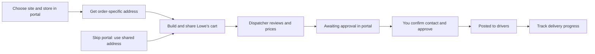

# Customer guide — Lowe's cart to delivery

> **Status (2026-11-18):** Requesting, approving in the portal, and tracking delivery are built. Payment and notifications are not built yet (see [What is not live yet](#what-is-not-live-yet)). Do not use this as a same-day delivery promise. The previous low-tech runbook is historical.

## How to submit a request

1. **Recommended:** Sign in to the portal and start a request before building the cart. Choose your job site and preferred Lowe's store; the portal provides a unique `delivery+<token>@<receiving-domain>` address for this request.
2. On the portal's last step, **copy the address**, then **open your store** on Lowe's. A short tutorial shows the steps the first time. On Lowe's:
   - Tap **Set as My Store** on the store page. On a phone it is below the map and opening hours.
   - Search with the **Pickup Today** filter. Items must be in stock at that store today.
   - Open your cart, tap the **✉** envelope (**Share** on a computer), paste the order-specific address as the recipient in **Email Cart**, and send it.

   **Do not purchase or check out at Lowe's.** A shared cart is a request, not a reservation or an order.

3. **Fallback:** If you skip the portal, send the cart to `delivery@mg.getlockstep.io`. The dispatcher must confirm your company, job site, and store manually. Do not use an address the app says is not ready; the old Gmail inbox and previously seeded `things.dispatch+<company>` address are not the advertised pilot route.
4. A dispatcher checks the items, store, delivery address and on-site contact, and enters the price. **Lowe's share-cart email does not include prices, store or job-site information.** The dispatcher may call you for anything missing.
5. When the order is ready, the dispatcher sends it for approval. **No email is sent** — the order shows as **Awaiting approval** in the portal under your orders.
6. Open the order, check the items, store, delivery address and estimated price, then:
   - Confirm the **on-site contact** name and phone, and any **delivery instructions**. These are the only details you can change here; the driver sees them.
   - Tap **Approve**. The job is posted to drivers straight away.
   - Wrong item, store or address? Call the number shown (864-346-8066) instead of approving.
7. Track the order on its page. **Delivery progress** shows each step the driver reaches, and the delivery photo once delivered.

## Before you share

- Use the **exact receiving address** supplied by the dispatcher or optional portal. The message comes from Lowe's; a one-use address identifies your saved site/store, while the shared `delivery@` address requires manual company confirmation.
- If you have several active job sites, provide the specific delivery address and preferred Lowe's location directly to the dispatcher. Do not assume the application inferred either from the cart.
- A successful share is not confirmation that a driver has accepted a job or that materials have been purchased. Check **Delivery progress** on the order page; the app sends no email.
- If you need to correct the cart, tell the dispatcher which email is the replacement. A genuinely new share-cart message may become a separate request; the old one is not automatically overwritten.

## What is not live yet

- **Payment.** Nothing is charged in the app today. Planned: approving takes you to pay, and the job posts to drivers only once the payment clears.
- **Notifications.** No email, text or push is sent — not when the order is ready to approve, nor when it is on the way or delivered. Check the portal or call. Push notifications to the home-screen app are planned first.
- **Editing items in the app.** To change items, call the dispatcher or share a new cart.
- **Other retailers.** Only Lowe's carts are read today. Home Depot is planned.

## Related

- [Dispatcher guide](dispatcher-guide.md) · [Email intake architecture](../architecture/05-email-intake.md)
