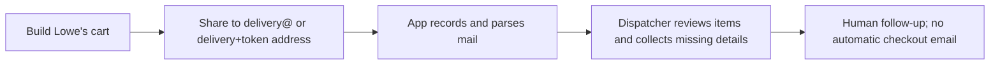

# Customer guide — Lowe's cart intake prototype

> **Status:** This describes the cart-request stage only. Dispatcher review, driver delivery, checkout, automatic updates and payment are not end-to-end customer features yet. Do not use this as a same-day delivery promise. The previous low-tech runbook is historical.

## How to submit a request

1. Build a cart on **Lowe's** for the location where the materials should be purchased. Check that the items appear available for pickup. **Do not purchase or check out at Lowe's.** A shared cart is a request, not a reservation or an order.
2. Use Lowe's **Share Cart** feature and enter the shared pilot Mailgun address `delivery@mg.getlockstep.io` as the recipient. The dispatcher confirms which company sent it before making an order. The old Gmail inbox and previously seeded `things.dispatch+<company>` address are **not** the advertised pilot route.
3. Alternatively, if you have a portal login, use the optional start-an-order flow to record your job site and preferred Lowe's store. After the dispatcher confirms this flow is ready, it shows a `delivery+<token>@<receiving-domain>` address specific to this request; share the cart to that exact address. The shared pilot address `delivery@mg.getlockstep.io` requires the dispatcher to select your company manually. Do not use an address the app says is not ready.
4. A dispatcher checks the items against the original Lowe's email and contacts you for any missing job-site address, store, on-site contact, materials estimate and delivery fee. **Lowe's share-cart email does not include prices, store or job-site information.**

## Before you share

- Use the **exact receiving address** supplied by the dispatcher or optional portal. The message comes from Lowe's; a one-use address identifies your saved site/store, while the shared `delivery@` address requires manual company confirmation.
- If you have several active job sites, provide the specific delivery address and preferred Lowe's location directly to the dispatcher. Do not assume the application inferred either from the cart.
- Do not treat a successful share or a status in the portal as confirmation that a driver has accepted a job, that materials have been purchased, or that any email from the application was sent.
- If you need to correct the cart, tell the dispatcher which email is the replacement. A genuinely new share-cart message may become a separate request; the old one is not automatically overwritten.

## What is not live yet

Automatic customer acknowledgement, checkout/price approval links, in-app substitutions, driver status alerts, payment links and Home Depot/Ace cart parsing remain future work. Existing `awaiting_customer` orders from the earlier prototype **did not cause an email to be sent**. Contact the dispatcher for status; do not wait for an automated message that has not been built.

## Related

- [Dispatcher guide](dispatcher-guide.md) · [Email intake architecture](../architecture/05-email-intake.md)
