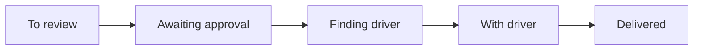

# Dispatcher Guide

Operating the delivery platform, order by order.

> **Status (2026-11-18):** Intake, review, customer approval in the portal, driver jobs and delivery evidence are built. Payment and notifications are not built yet; nothing happens to an order after **Delivered**. See [00-overview](../architecture/00-overview.md).
>
> This replaces the low-tech Google Sheets + Slack runbook in `External Notes/Low Tech Flow.pdf`. That process is retired.

---

## What changed from the old process

| Old process                                            | New process                                                 |
| ------------------------------------------------------ | ----------------------------------------------------------- |
| Read the cart email in Gmail                           | The system parses it; you review the result                 |
| Copy rows into a Google Sheet                          | Nothing to copy — the order exists                          |
| Manually set a "status" cell                           | Status advances through the app                             |
| Copy the sheet into a new tab, rename it, share a link | Nothing to copy                                             |
| Post to `#drivers` in Slack and wait                   | Approval posts the job; you send drivers its link           |
| Drivers reply in a thread; you transcribe updates      | Drivers update their own status and upload their own photos |
| Notice payment arrived, then set "Order Final"         | Not built yet — payment is planned at approval              |

The dispatcher role becomes **exception handling and judgement**, not data entry.

---

## Your daily loop

**Where:** `/dispatch/review`. The order list has tabs; clicking a tab opens its first order.

| Tab                   | What's in it                                                  |
| --------------------- | ------------------------------------------------------------- |
| **To review**         | New orders to check and price; inbound exceptions list beside |
| **Awaiting approval** | Sent for approval; waiting for the customer in the portal     |
| **Finding driver**    | Approved and posted; no driver has accepted yet               |
| **With driver**       | A driver has accepted, up to **On my way**                    |
| **Delivered**         | Delivered — the last step today                               |
| **All**               | Every order                                                   |



Nothing happens after **Delivered** yet: no payment request and no close-out.

---

## 1. Review the queue

**Where:** `/dispatch/review`

Inbound emails enter the **same worklist** as orders. How a cart arrives depends on which Mailgun route forwards it:

- **Raw-email route** (`/api/webhooks/mailgun/mime`): the retailer's DKIM signature is checked. A Lowe's cart whose signature verifies, sent to a known company or `delivery+` address, becomes an order on its own and appears in **To review** like any other. Anything else, including a Lowe's email whose signature doesn't verify, appears as a **provisional preview**.
- **Parsed-fields route** (`/api/webhooks/mailgun/inbound`, still Mailgun's current setting until it is switched to the raw-email route): **every** cart appears as a provisional preview.

A From address or DKIM header alone does not authenticate the sender. Verify the source and company before approving; approval runs the transactional finalization function. A `delivery+` address identifies its company and, while unused, previews the saved site/store before approval; the original email's requester address is only an unverified clue. An unknown address can be attached to a company only after off-platform verification, or dismissed. A failed parse shows its reason and original email; it **cannot** be approved as a valid item list. Request a fresh cart or wait for a later correction tool. No driver job is created from a provisional email.

### Resolving a failed parse

1. Open the inbound exception and read the original email in its restricted preview.
2. Compare the provisional names, Lowe's item/model numbers and quantities against that source. Lowe's share-cart emails **do not contain prices or a subtotal**.
3. If extraction failed, do not approve an incomplete list. Ask for a fresh cart, then **Dismiss without an order**. Manual item correction is planned, not built.
4. Only **Approve and create order** for a validated, legitimate email after confirming its company. This creates a `received` order for dispatcher review, **not** an `awaiting_customer` order.

You do not need to be fast. A cart that fails to parse is a signal the retailer changed their template, and it is worth flagging so the parser can be fixed.

---

## 2. Confirm delivery and Lowe's store

**Where:** the order detail page

For a direct email, contact the customer and record a complete delivery address, on-site contact name/phone, and any instructions. A portal-token request carries a saved address and store, but still needs an on-site contact. The cart email itself contains neither a store nor an address.

Confirm the selected store with the customer or choose one from the Lowe's list. Distances are only shown when the saved site has coordinates; a manually entered address has no fabricated distance. A store 2 mi or more further than the nearest one shows a warning on the **Store** check, but does not block sending. Save actions show a success or error message and append an audit event without changing the order status.

> **This is the highest-consequence manual step in the system.** Nothing in the email lets us verify the customer built their cart for the store you choose. A wrong store means a driver drives to the wrong place and the cart may not be purchasable there.

---

## 3. Price the order

**Where:** the order detail page

Pick the delivery size — **Car** or **Truck** — and enter the materials estimate, sizing fee and mileage fee. The total updates as you type:

```
materials subtotal + sizing fee + mileage fee − discount + tax = total
```

Lowe's sends **no materials prices** in the share-cart email. A dispatcher has to obtain the estimate and enter materials, sizing and mileage amounts by hand. The order's initial zero is an unknown amount, not a free delivery. The **Size & price** check passes only when a size is picked, materials are above $0, and the sizing and mileage fees are each at least $0.50.

### Driver payout

The payout defaults to 90% of the sizing fee plus mileage fee. You can change it until a driver accepts; after that it is locked at what the driver saw. It is never shown to the customer.

The fee structure is not yet settled — that is why you enter fees rather than the system calculating them. When the pricing model is decided, this becomes a rules table.

---

## 4. Send for approval

The bottom bar shows four checks: **Items**, **Store**, **Address & contact** and **Size & price**. When they pass, **Send for approval** moves the order to **Awaiting approval**. If something is missing, clicking it scrolls to and highlights that field instead. If an action fails, the bar shows an error.

**No email is sent.** The customer sees the order in the portal, where they confirm the on-site contact and drop-off instructions (the only details they can change) and tap **Approve**. Tell the customer it's ready if they aren't expecting it.

**Undo send** takes the order back to review until the customer approves.

### If the customer never approves

**The system does not expire the order.** Call the customer. There is no way to approve on their behalf in the app; that is not planned for the pilot.

Planned, not built: approving will take the customer to pay, and the order will stay **Awaiting approval** until the payment clears.

---

## 5. Dispatch

**Where:** the **Finding driver** tab

When the customer approves, the job is posted to drivers on its own. It shows in every active driver's **Open jobs**, but **nothing alerts them** — no text or push is sent. Use **Copy job link** on the order and send it to drivers yourself. **The first to accept wins** — you do not choose.

Before accepting, drivers see their payout, the store, the full delivery address, the items and the vehicle needed. The on-site contact and drop-off notes show only after they accept.

### If nobody accepts

Nothing expires and nothing alerts you. Watch the **Finding driver** tab and call drivers directly. Drivers can't decline yet; a Decline button, and an **All drivers declined** flag on this tab, are planned.

### If an assigned driver falls through

**Release driver** takes the job back from its driver at any step before delivery and posts it to drivers again. Photos already taken are kept. The driver is not notified, so call them.

---

## 6. Track and close

The driver advances the order — **I'm at the store**, **Items purchased**, **On my way**, **Delivered** — and uploads the receipt and delivery photos. You do not transcribe anything. The order shows the time of each step, the receipt and delivery photos, and any skip reason. The customer sees the steps and the delivery photo, never the receipt, driver name or skip reason.

**Photos are prompted but not required.** If a driver skips one, they must give a reason and you will see it on the order. Do not let skipped receipts become normal — the receipt is the evidence behind the charge.

Steps are forward only. You can't step a job back; if a driver taps the wrong step, use **Release driver** if needed.

### After delivery

**Delivered** is the last step today. There is no payment request and no close-out; the order stays in **Delivered**. Payment is planned at approval (see section 4), not after delivery.

---

## Exception handling

| Situation                           | What to do                                                                                                    |
| ----------------------------------- | ------------------------------------------------------------------------------------------------------------- |
| Cart didn't parse                   | Ask for a fresh cart, then dismiss. Manual item correction is planned, not built                              |
| Email arrived at an unknown address | Open the inbound exception → confirm the company (after verifying off-platform) and approve, or dismiss       |
| Customer won't approve              | Call them. Approving on their behalf is not built                                                             |
| Customer wants to change items      | Item editing is not built. If not yet approved, ask them to share a new cart                                  |
| Nobody accepts the job              | Send the job link again, or call drivers directly                                                             |
| A driver declines                   | Not built yet — drivers can't decline in the app. Planned: an **All drivers declined** flag on Finding driver |
| Assigned driver can't complete      | **Release driver** — the job is posted again; call the driver                                                 |
| Driver tapped the wrong step        | Steps can't be undone. Release the driver if the job needs to go to someone else                              |
| Customer disputes the price         | Check `order_status_events` — each draft save, send and approval is recorded there with who did it            |

---

## What you should never need to do

- Copy data between systems
- Transcribe a driver's status update
- Reconcile the day's orders by hand
- Post to Slack to find a driver

If you find yourself doing any of these, tell the team — it means something is missing.

---

## Related

- [Customer guide](customer-guide.md) · [Driver guide](driver-guide.md)
- [Order lifecycle](../architecture/04-order-lifecycle.md) — the authoritative state machine
