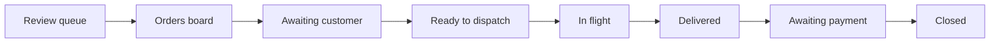

# Dispatcher Guide

Operating the delivery platform, order by order.

> **Status:** Pilot intake and inbound review are being prepared; migration `0009` is not applied. The delivery, checkout and payment sections below describe future behavior, **not** capabilities available for the client test. See [00-overview](../architecture/00-overview.md).
>
> This replaces the low-tech Google Sheets + Slack runbook in `External Notes/Low Tech Flow.pdf`. That process is retired.

---

## What changed from the old process

| Old process                                            | New process                                                 |
| ------------------------------------------------------ | ----------------------------------------------------------- |
| Read the cart email in Gmail                           | The system parses it; you review the result                 |
| Copy rows into a Google Sheet                          | Nothing to copy — the order exists                          |
| Manually set a "status" cell                           | Status advances through the app                             |
| Copy the sheet into a new tab, rename it, share a link | Nothing to copy                                             |
| Post to `#drivers` in Slack and wait                   | One button broadcasts; the system tracks acceptances        |
| Drivers reply in a thread; you transcribe updates      | Drivers update their own status and upload their own photos |
| Notice payment arrived, then set "Order Final"         | Stripe tells the system; the order advances itself          |

The dispatcher role becomes **exception handling and judgement**, not data entry.

---

## Your daily loop



---

## 1. Review the queue

**Where:** `/dispatch/review`

Inbound emails enter the **same worklist** as orders, but do not automatically become orders. A Lowe's email with validated line items appears as a **provisional preview**, since a From address or DKIM header alone does not authenticate the sender. Verify the source and company before approving; approval runs the prepared transactional finalization function once migration `0009` is applied. An unknown address can be attached to a company only after off-platform verification, or dismissed. A failed parse shows its reason and original email; it **cannot** be approved as a valid item list. Request a fresh cart or wait for a later correction tool. No driver job is created from a provisional email.

### Resolving a failed parse

1. Open the inbound exception and read the original email in its restricted preview.
2. Compare the provisional names, Lowe's item/model numbers and quantities against that source. Lowe's share-cart emails **do not contain prices or a subtotal**.
3. If extraction failed, do not approve an incomplete list. Ask for a fresh cart; the app does not yet offer manual item correction.
4. Only approve a validated, legitimate email after confirming its company. This creates a `received` order for dispatcher review, **not** an `awaiting_customer` order.

You do not need to be fast. A cart that fails to parse is a signal the retailer changed their template, and it is worth flagging so the parser can be fixed.

---

## 2. Set the store

**Where:** the order detail page

The cart email does **not** contain the store — this is a limitation of the retailer's email, not a bug. You must select it from the seeded store list.

Pick the store nearest the customer's delivery address. The delivery address is shown next to the store picker so you can sanity-check proximity.

> **This is the highest-consequence manual step in the system.** Nothing in the email lets us verify the customer built their cart for the store you choose. A wrong store means a driver drives to the wrong place and the cart may not be purchasable there.

---

## 3. Price the order

**Where:** the order detail page

Enter the sizing fee and the mileage fee. The total is computed:

```
materials subtotal + sizing fee + mileage fee − discount + tax = total
```

Lowe's sends **no materials prices** in the share-cart email. A dispatcher has to obtain the estimate and enter materials, sizing and mileage amounts by hand. The order's initial zero is an unknown amount, not a free delivery.

The fee structure is not yet settled — that is why you enter fees rather than the system calculating them. When the pricing model is decided, this becomes a rules table.

---

## 4. Checkout invite — future phase, disabled for the client pilot

The order detail's _Send checkout invite_ control is disabled. There is no outbound email or customer checkout page yet. Older prototype rows may show **"Invite queued — not sent"**; do not treat those records as customer contact. Collect missing site, store and materials details directly with the client until a confirmation flow is built and tested.

### If the customer never completes checkout

**The system does not expire the order.** Some customers will phone instead.

You can **complete checkout on their behalf**: enter the delivery address and instructions, and accept the price. The system records that a dispatcher did this and who, so the audit trail always answers "who agreed to this price?".

Do not do this without the customer's explicit confirmation on the record.

---

## 5. Dispatch

**Where:** order detail → _Find a driver_

Once the order is `customer_confirmed`, broadcast it. Every active driver is alerted by SMS and sees it in their app. **The first to accept wins** — you do not choose.

Drivers see the store, the item count, and their payout. They do **not** see the customer's address until they accept.

If a driver declines, you're notified and it shows on the order. If **every** active driver declines, the order is flagged **nobody available** — that's your cue to call around or widen the pool.

### If nobody accepts

The broadcast expires and you are notified. Options:

1. **Re-broadcast** — offers the job again to the same pool.
2. **Widen the pool** — if a driver is inactive or unavailable, contact them.
3. **Call a driver directly** and have them accept in the app.

There is no automatic re-broadcast. An order nobody accepts is a signal you should see, not something to retry silently.

### If an assigned driver falls through

Withdraw the assignment, which returns the order to `customer_confirmed`, then broadcast again.

---

## 6. Track and close

The driver advances the order through the delivery statuses and uploads the receipt and delivery photos. You do not transcribe anything.

**Photos are prompted but not required.** If a driver skips one, they must give a reason and you will see it on the order. Do not let skipped receipts become normal — the receipt is the evidence behind the charge.

### Request payment

Once delivered, send the payment request. The system creates a Stripe Payment Link for the exact total and emails it to the customer.

When Stripe confirms payment, the order moves to `paid` on its own, and the customer gets a receipt. You close the order.

---

## Exception handling

| Situation                           | What to do                                                                                                                                    |
| ----------------------------------- | --------------------------------------------------------------------------------------------------------------------------------------------- |
| Cart didn't parse                   | Review queue → correct items → verify the subtotal reconciles                                                                                 |
| Email arrived at an unknown address | Review queue → attach to the right company or dismiss                                                                                         |
| Customer won't complete checkout    | Complete it on their behalf, with their confirmation on record                                                                                |
| Customer wants to change items      | Edit items on the order detail, then re-send the checkout invite. **Any change invalidates an existing payment link** — the system flags this |
| Nobody accepts the job              | Re-broadcast, or contact drivers directly                                                                                                     |
| A driver declines                   | You're notified; the decline shows on the order. If all active drivers decline, call drivers directly                                         |
| Assigned driver can't complete      | Withdraw the assignment, re-broadcast                                                                                                         |
| Customer disputes the price         | Check `order_status_events` and the `confirmed_by` field — the full history is there                                                          |
| Payment link expired unpaid         | Issue a new one                                                                                                                               |

---

## What you should never need to do

- Copy data between systems
- Transcribe a driver's status update
- Notice that a payment arrived
- Reconcile the day's orders by hand
- Post to Slack to find a driver

If you find yourself doing any of these, tell the team — it means something is missing.

---

## Related

- [Customer guide](customer-guide.md) · [Driver guide](driver-guide.md) · [Dry-run checklist](dry-run-checklist.md)
- [Order lifecycle](../architecture/04-order-lifecycle.md) — the authoritative state machine
